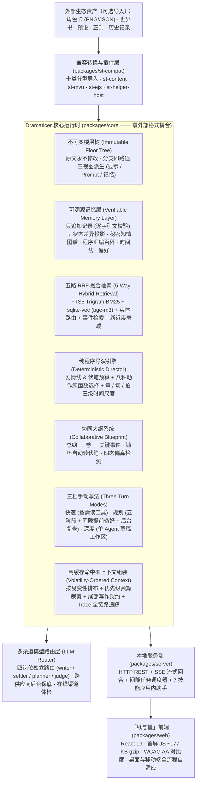

<div align="center">

# Dramaticer

**新一代 AI 角色扮演与交互式叙事运行时**  
*Next-Generation Narrative Runtime for Long-Horizon AI Role-Playing*

[](https://nodejs.org/)
[](https://www.typescriptlang.org/)
[](https://www.sqlite.org/)
[](#质量门禁与评测体系)
[](#质量门禁与评测体系)
[](#44-纸与墨设计系统与无障碍paper--ink-ui)
[](LICENSE)

[**设计总案 (DESIGN v1.0)**](docs/DESIGN.md) · [**统一命名表 (GLOSSARY)**](GLOSSARY.md) · [**架构决策记录 (166 ADRs)**](docs/dev/DECISIONS.md) · [**插件开发文档**](docs/plugins/) · [**快速开始**](#-快速开始)

---

> **「把故事当作有结构的系统来运行——程序管事实与调度，模型管文笔与意图。记忆管过去，导演管未来。」**

</div>

---

## 1. 摘要与愿景（Introduction & Vision）

大语言模型（LLM）让自由开放的交互式叙事成为可能，但当下的 AI 角色扮演（AIRP）生态仍停留在一个脆弱的范式里：**将角色卡、世界书、预设与聊天记录拼接成一段不断膨胀的字符串，再寄希望于单次推理同时完成「记住所有过往、恪守角色知情边界、推进长线戏剧冲突、维护状态数值与撰写正文」**。

当故事延伸到几百乃至上千楼、世界观扩展到数万字时，这一「全字符串化（Stringified Everything）」范式的物理极限便暴露无遗：
- **灾难性遗忘与信息串戏**：模型记不住百楼前的伏笔，或者让不在场的角色凭空知晓未公开的秘密。
- **叙事停滞与空转**：缺乏长线戏剧张力调度，剧情在日常寒暄里原地打转，埋下的线索无人回收。
- **有效算力被记账吞噬**：实证语料分析表明，模型近一半的输出 token 被迫消耗在状态栏渲染、变量更新与摘要复述上，不仅挤占了正文创作空间，更频繁导致截断与格式崩坏。

**Dramaticer 的使命，是终结「字符串拼贴」时代，为长程 AI 叙事构建一套严谨、可验证、可解释的底层运行时（Narrative Runtime）。**

我们不把 Dramaticer 定义为「又一个聊天前端」或「又一种卡片格式」。正如现代游戏引擎将物理模拟与画面渲染解耦、数据库将事务日志与物化视图分离，Dramaticer 在大模型之上建立了一套**基于不可变事件溯源（Event Sourcing）、确定性状态投影（Deterministic Projection）与零开销间隙调度（Zero-Cost Gap Scheduling）**的叙事计算架构：

1. **记忆管过去（Memory Governs the Past）**：以不可篡改的楼层树为唯一真相源（Single Source of Truth），在回合间隙将散文转化为带**逐字原文引文校验**的只追加记录，进而由确定性程序投影出状态、秘密知情图谱、实体百科与多级时间线。
2. **导演管未来（Director Governs the Future）**：将剧情线、阻碍、倒计时与伏笔账结构化；通过**零模型调用的纯函数动作选择器**在玩家留白时供给戏剧张力，而在玩家自主表达时彻底退居幕后。
3. **兼容只是入口，不是地基（Compatibility as an Entryway, Never the Foundation）**：完整兼容现有社区的角色卡（V1–V3 PNG/JSON）、世界书、预设、MVU 变量、EJS 模板与酒馆助手脚本，但在架构上将所有外部生态语义严格隔离在单向转换层与沙箱插件中，保持核心运行时的绝对纯净。

---

## 2. 实证诊断与架构创新（Empirical Diagnosis & Architectural Innovations）

Dramaticer 的每一项架构设计均建立在对真实长线角色扮演语料的定量取证之上（详见 [`docs/DESIGN.md` §2](docs/DESIGN.md)）：

| 传统生态的实证瓶颈 | 取证统计数据 | Dramaticer 的系统级解法 |
|---|---|---|
| **世界书常驻膨胀** | 92.6% 的大型角色卡内嵌世界书；每本中位数 70 条，每轮固定常驻约 **28,000 字符** | **十类运行时行为分型导入**：按条目语义分流为*常识、人物地点、规则、数值、有条件、事件、文风、素材、选项、旧总结*，仅常识常驻，其余按出场、条件或导演按需调度 |
| **提示词内嵌脚本泛滥** | 世界书中 **24.0%** 为变量与更新规则，**23.6%** 为 EJS 模板（其中 90% 为条件分支） | **原生状态台账与条件段**：数值转为结构化台账由后台更新；条件内容走原生条件语言；复杂遗留脚本隔离至 `st-ejs` / `st-helper-host` 沙箱插件 |
| **生成算力浪费在记账** | **45%** 的模型回复携带变量更新块，**45%** 携带总结块 | **正文与记账彻底解耦**：主模型在回合内只写故事正文；状态抽取、场记、归档全部移至回合后的**后台间隙（Gap）**，显示层状态栏由程序确定性绘制 |
| **推进乏力与高频返工** | 玩家 **18%** 的输入为请求推进；重 roll 主因依次为：**不推进 (19.3%)、没听指示 (18.2%)、格式乱 (13.7%)、截断 (13.0%)、遗忘 (5.6%)** | **导演八动作 + 带原因重写闭环**：提供「一步 / 一场 / 跳跃」三档推进与行动选项；重写原因既作为本轮纠正注入，又自动去重沉淀为长期玩家偏好 |
| **开局冷启动塌缩** | 故事 **1–10 楼**重 roll 率高达 **24.9%**（10 楼后降至 **7–10%**） | **异步开局包与首楼候选**：导卡后后台自动分析场上冲突并预先生成 2–3 个开场白候选；前 10 楼导演主动提高介入权重 |

### 核心架构突破



---

## 3. 核心架构支柱详解（Core Architectural Pillars）

### 3.1 不可变楼层树与三视图派生（Immutable Floor Tree & Tri-View Derivation）
- **数据库级不可变保证（不变量 I4）**：每一楼（`nodes` 表）的原始文本 `raw` 一旦写入即由 SQLite `BEFORE UPDATE` 触发器永久锁定，存储层不提供任何修改 `raw` 的接口。玩家的重写（swipe）、就地编辑、改这句（局部重写），以及后台复查生成的修正稿，全部作为指向同一父节点的**兄弟节点**插入，分支切换仅需移动故事的 `head_node_id` 指针。
- **块协议与三视图派生（不变量 I8）**：流式增量解析器实时识别 `<thinking>`、`<选项>`、`<状态栏>` 等结构块，从同一份不可变原文确定性地派生出三种视图：
  1. **显示视图（Display View）**：在阅读界面渲染为折叠思考链、交互式选项卡片、页边批注或沙箱状态栏。
  2. **提示词视图（Prompt View）**：历史楼层中的状态栏、变量更新、分析与选项块自动剥离（仅最近一楼保留完整原文），大幅降低上下文噪声并保护大模型 API 的前缀缓存（Prefix Cache）。
  3. **记忆视图（Memory View）**：剔除元指令与装饰块后的纯净叙事文本，送入 trigram 全文索引、向量分块与后台事实抽取。

### 3.2 可溯源记忆层：事件溯源与程序汇编百科（Verifiable Memory Layer）
记忆层彻底摒弃了「让模型直接覆写总结文档」的脆弱做法，严格划分为**原文层 → 整理知识层 → 本轮上下文层**：
- **只追加记录与逐字出处校验（Append-Only Event Log with Verbatim Quote Verification）**：每楼落定后，后台在间隙运行一次场记（`scene_log`），抽取包含故事时间、地点、参与者、知情者、重要度及**原文逐字引文（`sourceQuote`）**的事实记录（`memory_events` + `memory_event_quotes`）。结算器强制检验 `sourceQuote` 必须逐字出现在源楼层原文中，任何虚构或篡改引文的条目整条拒绝并记入 `memory_rejections`。数据库触发器禁止对记录表执行 `UPDATE` 或 `DELETE`。
- **按楼层存差异的状态台账（State Diffs & Settlement，不变量 I5、I12）**：人物位置、衣着、伤势、持有物、关系与卡片自定义数值，按楼层存储 `set` / `delete` 差异（`state_diffs`），沿当前分支路径累加得出任意楼层的精确状态快照。所有写入（无论来自模型、后台结算还是插件）均须通过结算器的 Schema 校验与修复。
- **防串戏秘密图谱与知情标注（Epistemic Secret Tracking）**：系统按「在场即知情；转述、偷听、书信由场记显式标注」的规则推导每条秘密的 `knowers`（知情者）与 `unaware`（不知情者）。组装上下文时自动注入**知情标注**（明确提醒写作模型「某角色当前不在场或不知晓某事」）；在「规划写法」下，角色的意图调用更是在物理输入层直接剥离该角色不知情的事件与秘密。
- **程序确定性汇编百科（Program-Compiled Wiki Pages）**：对照实验（ADR-0130）证明，让大模型直接维护人物 Wiki 页面会引入显著的幻觉与前后矛盾。Dramaticer 的百科页面（人物、地点、势力、物品、剧情线）**完全由程序（`compileWikiPages`）从该实体关联的全部只追加记录、当前状态与章末反思中汇编生成**——每一句断言都带有楼层号与原文出处，任何一页随时可以从原文重新编译。
- **五路 RRF 融合检索与重逢提醒（5-Way Hybrid Retrieval & Reunion Injection）**：
  - **重逢提醒**：当久未出场的人物、地点或重要物品在玩家输入或导演安排中被再次提及时，程序自动按实体名与别名注入其百科页面与历史原文摘录。
  - **五路融合检索**：同时运行 **BM25 全文检索**（SQLite FTS5 `trigram` 分词，原生支持中文无空格检索）、**稠密向量检索**（`sqlite-vec` KNN，`BAAI/bge-m3` 1024 维）、**实体图谱路由**（由在场者与玩家提及的实体驱动）、**结构化事件检索**与**新近度衰减**，通过倒数秩融合（RRF，默认权重 `2.0 : 1.0 : 0.5 : 0.5 : 1.0`，ADR-0084）排序，并支持可选的 `BAAI/bge-reranker-v2-m3` 交叉编码重排序。当故事总长度尚在历史原文窗口容量内时自动跳过检索，实现按需付费。

### 3.3 导演引擎：三级时间尺度与不干扰原则（The Director Engine）
导演系统负责解决长线故事的「停滞」与「伏笔烂尾」，其最高准则是：**只填补玩家留下的空白，绝不覆盖玩家的选择（不变量 I9）**。
- **结构化剧情线与伏笔预算（Plot Lines & Promise Budget）**：每条剧情线（`DirectorLine`）包含种类（*主线问题 `main`、人物关系 `relationship`、对手图谋 `opposition`、伏笔与约定 `promise`*）、主体与诉求（`who` / `want`）、阻碍与代价（`obstacle`）、按助手楼层递减的倒计时（`countdown`）及后台预备的 2–3 种发展方向（`preparations`）。未兑现的伏笔受硬预算上限约束（默认 5 条，可按档位调整），越陈旧的伏笔越优先触发回收提醒。
- **章 · 场 · 拍三级时间尺度**：
  - **章（Chapter）**：每章结束触发一次后台规划（`chapter_plan`），依据本章玩家的真实自由输入清点所有剧情线（收束、作废、新开、改写阻碍）并生成下一章的三个候选方向。
  - **场（Scene）**：场次边界由场记自动判定（12 楼兜底），新场景开启时生成**本场目标（场面卡 `SceneCard`）**——定义在场每个角色本场想要什么，以及本场结束时局面应当发生什么实质改变。
  - **拍（Beat / 每轮）**：由**零模型调用的纯函数 `selectDirectorAction`** 根据场记节拍、线冷热度与倒计时，从八种戏剧动作中选出本轮建议：**不干预（让位 `yield`）、顺势（接球 `catch`）、加阻碍（加码 `escalate`）、突发（闯入 `intrude`）、收伏笔（兑现 `fulfill`）、揭秘（揭示 `reveal`）、缓一缓（喘息 `breathe`）、换场（转场 `transition`）**。同一动作禁止连续使用 3 次，选择理由完整记入 Trace。
- **严格的「不干扰玩家」机制**：
  - **按内容而非字数识别意图（`readPlayerIntent`）**：只要玩家写出了自己的行动（哪怕只有几个字），导演立刻判定为自由输入并选择**「不干预（`yield`）」**——不向提示词注入任何导演指令；只有玩家点击「推进（一步 / 一场 / 跳跃）」或输入「继续、推进剧情」等固定短语交出方向盘时，导演才出手安排。
  - **突发延后与单场打断上限**：玩家自主行动期间，倒计时到点的剧情线自动延后到下一次推进或场次结束；仅显式标记为 `mustInterrupt: true` 的紧急事件允许打断，且每场最多打断一次。
  - **「这不是我要的」一键撤回（`undoDirectorArrangement`）**：页边批注中的每条导演安排均附带撤回按钮，点击后在单一数据库事务内撤回该安排、永久静音对应剧情线，并写入一条 `avoid-line` 长期偏好。

### 3.4 协同大纲系统（Collaborative Blueprint）
- **总纲 → 卷 → 关键事件（里程碑）**：总纲定义故事的核心问题、基调、候选结局、绝对不要触碰的红线及约束强度（*弱 / 中 / 强*，默认*弱*）；关键事件不死绑具体楼层号，遵循「远粗近细」原则。
- **铺垫自动转伏笔与防剧透注入**：关键事件声明的前提条件在章末清点时自动生成确定性 ID（`milestone.<sha256>`）的伏笔线交给导演追踪。向写作模型注入大纲时**严格过滤剧透**——模型只看到「当前卷核心问题、最近一个关键事件方向、本章待埋伏笔」三项摘要，绝不泄露候选结局与后续卷内容。
- **四态偏离检测（Deviation Check）**：每章结束自动评估关键事件状态（*未达 / 达成 `achieved` / 受阻 `blocked` / 已偏离 `lost`*）。一旦发现玩家行动导致剧情偏离大纲，界面呈现三个选择（*顺应剧情调整大纲、让导演拉回剧情、放弃该事件*），系统绝不自作主张改写大纲或强扭玩家行动。

### 3.5 玩家可以改一切（Player Agency & Edit-Everything）
除不可变楼层原文外，运行时内的所有结构化知识对玩家完全透明、可就地编辑、可锁定、可回滚：
- **作者内容的故事级副本**：设定（世界书条目）、人物设定、规则、写作选项修改的是**当前故事的独立副本**（`player_edits` 表），支持单条或全量「恢复原卡」，支持测试某条设定「在当前场面下会不会带上（`lorePreview`）」，并在角色卡作者发布新版卡时提供可视化差异比对（新增 / 修改 / 移除）与保留玩家锁定项的无损升级。
- **玩家锁定绝对优先（`guardBackgroundWrite`）**：玩家对百科语句、状态键值、秘密知情名单、时间线摘要、偏好、剧情线、本场目标或大纲的任何就地修改，校验通过后**立即生效**（无需走待审变更卡，仅 AI 提出的修改才走变更卡审批），并自动标记 `locked: true`。后台任何任务试图覆写玩家锁定项时均被内核直接拦截。
- **沿分支路径的版本历史**：所有玩家编辑记录均挂载在当前楼层节点上沿分支路径累加，切换故事分支即刻还原对应分支的设定与记忆状态，任意一次修改均可一键回滚。

### 3.6 三种写法与间隙预跑（Turn Modes & Gap Pre-Computation）
三种写法**只能由玩家在输入台手动切换**，程序绝不自动越权切换（不变量 I6、I13）：

| 写法 | 执行流水线 | 核心特性与防失控预算 |
|---|---|---|
| **快速**<br/>(`fast`，默认) | 上下文组装 → 单次流式主模型调用（可按需调用 `memory_search`、`ledger_read`、`lore_lookup`、`state_get` 四个本地读取工具） | 最低首字延迟；读取工具软上限默认 3 轮；不强制模型调用工具 |
| **规划**<br/>(`plan`) | 固定五阶段流水线（`PLAN_TURN_STEPS`）：<br/>1. **挑记忆**：从百科与设定目录挑选本轮最相关的 ≤ 6 条材料<br/>2. **角色意图**：在场角色（≤ 4 人）**每人独立一次调用**，输入仅含该角色自身状态、知情事件与被告知的秘密<br/>3. **定计划**：综合玩家输入与角色意图，制定 3–5 行本楼事件先后计划<br/>4. **写正文**：流式生成正文<br/>5. **后台复查（`plan_review`）**：正文落定后在后台检查状态矛盾与知情串戏，发现问题自动改写并存为兄弟楼层供玩家一键切换，**零阻塞正文显示（不变量 I7）** | 开启**「提前备好（`plan_prepare`）」**后，系统趁玩家阅读与思考的间隙，预先对「推进三档」与当前楼层的「候选行动选项（最多 5 条）」跑完前三个准备阶段并缓存；玩家点击推进或选项时，**回合内只剩一次写正文调用，兼得规划的严密性与快速写法的低延迟（不变量 I11）** |
| **深度**<br/>(`deep`) | 单 Agent 草稿工作区循环（`runDeepTurn`）：<br/>故事数据实时映射为虚拟只读文件树（`故事/状态.md`、`故事/秘密.md`、`故事/节拍.md`、`故事/时间线.md`、`故事/偏好.md`、`故事/伏笔.md`、`故事/大纲.md`、`故事/手记.md`、`故事/历史.md`、`故事/人物/<名字>.md`）；模型通过 `file_read`、`file_search` 调研，在 `草稿.md` 上使用 `file_write`、`file_patch` 起草与修补，对照程序生成的**【交稿前自查】**清单（状态一致性、不知情者防串戏、节拍变化、玩家偏好、待收伏笔）核对无误后调用 `commit_draft` 提交 | 防失控上限：默认最多 40 次工具调用、10 分钟运行时长、48,000 工具上下文 token（超限时自动从最早的一对工具往返开始成对省略，保留最近 4 步）；模型若跳过工具直接输出正文，系统同样接住并落为楼层 |

### 3.7 高缓存命中率上下文组装与写作契约（Context Assembly & Writing Contract）
- **按易变性排布（`contextLayout: volatility`，默认）**：为最大化复用大模型 API 的前缀缓存（Prompt Caching），15 个标准槽位严格按「从静态到动态」排布：
  `character / persona / 常驻常识 lore`（故事级恒定） → `user_will / 故事索引 / summary（只追加章节档案）` → `history（历史楼层 Prompt 视图）` → `state / scene / profile / reunion / memory / scene_card / blueprint / director`（每轮动态槽位） → `玩家本轮消息 & 写作选项要求` → `protocol（写作契约，永远垫底）`。
- **尾部写作契约（Writing Contract）**：永远位于上下文最末尾，向模型申明四条铁律：玩家输入是本轮方向指引而非既成事实；其他角色拥有独立意志，可以拒绝或反驳玩家；每一楼都必须产生实质剧情变化；严格遵守玩家偏好与「不要替玩家角色说话或行动」的边界。
- **上下文包缓存（`ContextPack`）与全链路 Trace**：同一玩家楼层的五路检索、世界书预筛与现场分析结果持久化为 `ContextPack`，重写（swipe）时直接复用。每一楼均保存完整的 `TurnTrace`，在故事页「上下文」停靠栏中精确展示模型看到的每一段内容、token 占比、缓存命中量及逐条来源对象（点击任意一条即可直接跳转到设定页、记忆页或源楼层对应位置进行修改）。

### 3.8 多渠道模型路由、四岗位解耦与跨供应商后台保底（LLM Routing & Cross-Provider Fallback）
- **四岗位独立路由（Role-Based Routing）**：在 `data/channels.yaml` 中将模型调用解耦为四个专业岗位——`writer`（正文创作）、`settler`（后台台账结算与抽取）、`planner`（导演章末规划、开局包、大纲建议与规划准备）、`judge`（评测裁判，启动时强制校验与 `writer` 必须属于不同模型家族）。
- **多渠道故障转移 + 跨供应商后台保底（`fallback`，ADR-0165）**：
  - 同一模型可配置多个渠道按优先级故障转移；内置截断检测（`finish_reason === "length"`、标签未闭合、句子中断）与自动续写。
  - 后台模型支持配置 `fallback: bg-fallback` 指向**另一家供应商**的渠道。当主后台渠道因额度耗尽（HTTP 402）、账户停用（403）或连续 5xx 不可用时，后台岗位自动无缝切换到保底模型，确保场记、记忆与导演永不掉线；而 **`writer` 正文岗位绝不自动跨模型切换**，避免同一故事中途混入不同模型的文风。
- **后台健康监控与自愈提示（`readBackgroundHealth`）**：若后台任务连续 3 次因所有渠道均失败而停摆，故事页顶部自动浮现醒目提示条，写明受影响的岗位、模型与脱敏后的错误原因；正文写作仍可继续，待渠道恢复并成功执行任意一条任务后提示条自动消失，落下的楼层由后台队列自动补算。
- **在线渠道体检（Channel Probe）**：支持在 Web 设置页或 CLI 按渠道、按模型、按岗位一键体检，实测真假流式、原生函数调用支持度（不支持时自动切换到 `<tool name="…">{json}</tool>` 文本协议）、思考参数兼容性与缓存命中透传。

---

## 4. 生态兼容与插件架构（Ecosystem Compatibility & Plugin Architecture）

### 4.1 十类分型导入与四个兼容插件
Dramaticer 支持直接导入社区现有的角色卡（V1 / V2 / V3 PNG 与 JSON）、世界书、预设与历史聊天记录。「导入检查」页面会直观展示分型后的条目分布，以及**优化模式相比原样模式每轮固定带入 token 的前后对比**。

所有酒馆兼容语义均通过四个插件在 `packages/st-compat` 中实现，与 `packages/core` 完全解耦（不变量 I1、I15）：
1. **`st-content`**：复现世界书激活规则、时间与随机宏（`{{pick}}`、`{{roll}}`、`moment` 时间宏）、酒馆正则三层处理与预设映射（能对应原生写作选项的条目自动转为文风/人称/长度/节奏/尺度/思考旋钮，其余条目聚合为可整体开关的「文风包」）。
2. **`st-mvu`**：支持 MVU 变量读写语法，将变量单向映射至台账的 `mvu.*` 命名空间，所有写入同样经过结算器校验。
3. **`st-ejs`**：兼容 ST-Prompt-Template 的 EJS 模板语法与 `lodash` 变量路径读写，在受墙钟时间预算保护的沙箱中同步求值。
4. **`st-helper-host`**：支持酒馆助手脚本与自定义 HTML 状态栏，在浏览器的沙箱 `iframe` 中隔离渲染，状态栏自动重渲染设防失控上限。

### 4.2 声明式插件与 Worker 代码插件沙箱
- **统一插件内核**：`core/src/plugins/` 提供了基于 `Context` 与 `ExtensionRegistry` 的微内核，内置的 15 个上下文槽位、17 种后台任务、导演机制与工具集均基于同一套插件契约构建，支持 `emit`、`parallel`、`serial`、`bail`、`waterfall` 五种扩展点分发模式。
- **声明式插件（主力）**：纯 JSON/YAML 数据包（定义自定义状态 Schema、剧情小品、上下文模板、块渲染器、助手技能、导演参数），可直接内嵌在角色卡的 `extensions.dramaticer` 字段中随卡分发。
- **代码插件与权限沙箱（不变量 I16、I17、I18）**：第三方 JS 代码插件运行在独立的 Node `worker_threads` 中，仅通过能力中介（Capability Broker）与内核通信；安装时必须声明并向玩家展示权限清单，未声明的调用直接拒绝并记录；回合内插件钩子受严格的时间预算（默认超时跳过并记入 Trace）约束，且插件永远无法直接修改楼层原文或绕过结算器写状态。

### 4.3 七技能应用内助手与只读排障
故事页内置与正剧严格隔离的**应用内助手**（独立存储在 `assistant_conversations` 表，绝不写入楼层树或污染正剧上下文），提供七项专职技能：
- **排障（`troubleshoot`）**：读取指定楼层的 Trace、上下文分段、检索名次、台账与导演决策，每一条结论均附带字段与数值证据，回答「为什么这么写、为什么忘了某件事」（命令行对应零模型调用的 `dramaticer explain --node <id>`）。
- **使用指南（`guide`）**：全文检索内置文档库（`docs/`），按命中的设计章节准确回答功能用法。
- **台账修订（`ledger_revision`）**、**参谋（`strategy`）**、**资料员（`research`）**、**卡片工坊（`card_workshop`）**、**设置向导（`setup_wizard`）**：通过自然语言协助玩家查询设定或起草修改方案——**所有涉及状态、设定、大纲、导演计划或渠道配置的修改均只生成待确认提案（Proposal / Change Card），必须经玩家本人点击批准后才会生效**。

### 4.4 「纸与墨」设计系统与无障碍（Paper & Ink UI）
前端（`packages/web`）采用自研的**「纸与墨（Paper & Ink）」**视觉系统（`src/v4/v4.css`）：
- **克制的东方书籍美学**：亮色为温润的宣纸色（`#f5f0e6`），暗色为沉静的松烟墨（`#151412`），支持「跟随系统 / 亮 / 暗」实时切换；**朱砂（`#b03a2e` / `#d9634e`）**作为全界面唯一的强调色，仅用于主操作、当前位置印章与导演留下的批注痕迹。
- **严苛的体积预算与性能门禁**：彻底移除三维 WebGL 背景、玻璃模糊（`backdrop-filter`）与打包字体文件，完全使用本机优质衬线与无衬线字体栈。每次 E2E 测试前由 `packages/web/scripts/budget.mjs` 强制校验：**首屏 JS ≤ 200 KB（当前实测 ~177.4 KB gzip）、CSS ≤ 40 KB（当前实测 ~16.3 KB gzip）、打包字体文件 = 0 个**。
- **WCAG AA 无障碍与双端原生体验**：亮暗两套配色的全部文本对比度均由 `design-tokens.test.ts` 自动校验通过 WCAG AA 标准；桌面端（1440px 三栏手稿布局）与移动端（390px 底部抽屉与防焦点跳动输入台）均通过完整的 Playwright 自动化验收；支持全键盘操作、`Ctrl + K` 全局命令面板与 `prefers-reduced-motion` 零动效模式。

---

## 5. 快速开始（Quick Start）

### 环境要求
- **Node.js ≥ 22.19**（支持 Windows、macOS、Linux）
- **pnpm 10.32+**（从源码构建时使用，建议通过 `corepack enable` 启用）
- 一个或多个大模型 API 渠道（支持所有 **OpenAI 兼容接口**、Google Generative AI 与 Google Cloud Vertex AI）

---

### 方式一：使用 Windows 绿色便携整合包（开箱即用，推荐）

项目提供打包好的自包含绿色便携发行包（位于 `dist-release/dramaticer-v0.1.0-win32-x64.zip` 或同名目录，已内置全部编译产物与 `better-sqlite3` / `sqlite-vec` 原生运行时依赖，无需安装 pnpm 或编译工具链）：

1. **解压** `dramaticer-v0.1.0-win32-x64.zip` 到任意目录（确保机器已安装 Node.js ≥ 22.19）。
2. **配置密钥**：打开目录下的 `.env`（若不存在，首次运行会自动从 `.env.example` 生成），填入你的模型接口地址与密钥：
   ```dotenv
   # 正文写作主模型
   DRAMATICER_MAIN_BASE_URL=https://你的网关或官方地址/v1
   DRAMATICER_MAIN_API_KEY=sk-xxxxxxxxxxxxxxxx
   DRAMATICER_MAIN_MODEL=你的主模型名称

   # 后台模型（结算、场记、归档、导演规划）
   DRAMATICER_BG_BASE_URL=https://你的后台模型地址/v1
   DRAMATICER_BG_API_KEY=sk-xxxxxxxxxxxxxxxx
   DRAMATICER_BG_MODEL=你的后台模型名称

   # 强烈建议：另一家供应商的后台保底模型（主后台 402/403/5xx 时自动无缝接管）
   DRAMATICER_BG2_BASE_URL=https://另一家供应商地址/v1
   DRAMATICER_BG2_API_KEY=sk-xxxxxxxxxxxxxxxx
   DRAMATICER_BG2_MODEL=你的保底后台模型名称
   ```
3. **双击 `start.bat`**（或在 PowerShell 7 中运行 `.\start.ps1`）：
   - 启动器会自动校验环境、初始化 `data/channels.yaml`、启动本地服务（默认 `http://127.0.0.1:8787`）并自动打开浏览器。
   - 命令行工具可通过目录内的 `dramaticer.bat <子命令>` 直接调用。

---

### 方式二：从源码克隆与构建

```bash
# 1. 克隆仓库并安装依赖
git clone https://github.com/Theater-ahyeon/Dramaticer.git
cd Dramaticer
corepack enable
pnpm install

# 2. 初始化环境变量与渠道配置文件
cp .env.example .env
mkdir -p data
cp channels.example.yaml data/channels.yaml
cp images.example.yaml data/images.yaml   # 可选：连接本地 ComfyUI 生图时复制

# 3. 编辑 .env 填入 API Key 后，构建全仓并启动服务
pnpm build
pnpm serve
```

服务启动后浏览器访问 **<http://127.0.0.1:8787>**：
1. 在**书架**页点击「导入一张卡」，选择你的 PNG 或 JSON 角色卡（可同时附带世界书与预设）。
2. 在**导入检查**中查看十类分型结果与每轮常驻 token 节省比例（可随时在「优化 / 原样」模式间切换）。
3. 进入**故事**页，从后台生成的开局候选里挑选一个作为开场，或直接输入你的行动、点击「推进（一步 / 一场 / 跳跃）」开始长线故事。

> **生成绿色便携安装包**：在源码根目录执行 `pnpm package:release`（或 `node scripts/package-release.mjs`），即可在 `dist-release/` 下重新生成完整的绿色便携目录与 `.zip` 安装包。

---

## 6. 配置与运维手册（Configuration Reference）

### 6.1 环境变量（`.env`）

| 变量名 | 必填 | 用途说明 |
|---|---|---|
| `DRAMATICER_MAIN_BASE_URL` / `API_KEY` / `MODEL` | 必填 | 承担正文生成的 `main` 渠道与模型 |
| `DRAMATICER_BG_BASE_URL` / `API_KEY` / `MODEL` | 必填 | 承担结算、场记、归档与导演规划的 `background` 渠道与模型 |
| `DRAMATICER_BG_REASONING_EFFORT` | 可选 | 后台模型思考强度（`off` / `minimal` / `low` / `medium` / `high` / `xhigh` / `max`） |
| `DRAMATICER_BG2_BASE_URL` / `API_KEY` / `MODEL` | 推荐 | 跨供应商后台保底（`bg2` 渠道 + `bg-fallback` 模型），防止单家额度耗尽导致记忆与导演停摆 |
| `SILICONFLOW_API_KEY` | 可选 | 用于 `BAAI/bge-m3` 向量嵌入与 `BAAI/bge-reranker-v2-m3` 重排序 |
| `DRAMATICER_SERVER_PASSWORD` | 条件必填 | Web 访问密码；监听 `127.0.0.1` 时可选，**`--host` 绑定非回环地址（如 `0.0.0.0`）时强制必填** |
| `GOOGLE_APPLICATION_CREDENTIALS` / `GOOGLE_CLOUD_PROJECT` / `GOOGLE_CLOUD_LOCATION` | 可选 | 使用 `google-vertex` 渠道时的 GCP 服务账号凭证路径、项目与区域 |

### 6.2 渠道与四岗位路由（`data/channels.yaml`）

- **安全红线**：`channels.yaml` 中的 `apiKey` 只允许写 `${环境变量名}` 引用或空字符串，严禁写入明文密钥。
- **启动自检提醒**：服务启动时会自动审计 `channels.yaml`——若后台模型未配 `fallback`，或 `fallback` 与主后台模型共用了同一个物理渠道，终端日志与 Web 设置页均会给出明确告警。
- **可视化管理**：除了直接编辑 YAML 文件，你也可以在启动后前往 Web 界面的「设置 → 模型 → 选渠道和模型（或更多 → 渠道）」中进行可视化配置与在线体检。

### 6.3 功能开关与三档预设

在「设置 → 功能」分页中，所有运行时能力被组织为**记忆、导演、表现、模型与兼容**四组，并提供三个一键档位：

| 档位 | 代码标识 | 默认开启的能力组合 | 适用场景 |
|---|---|---|---|
| **省** | `lite` | 状态面板、写作指令层、导演（仅推进时）、伏笔上限 3 | 极低后台 token 消耗，适合快速试卡或轻量对话 |
| **均衡**（默认） | `standard` | 场记、档案归档、重逢注入、全文检索、复查、导演（仅推进时）、知情标注、伏笔上限 5、规则执行、状态面板、行动选项、工具查阅、写作指令层 | 记忆层与导演层全面协同，长线游玩的推荐配置 |
| **全开** | `immersive` | 在「均衡」基础上额外开启：**提前备好（间隙预跑）**、出图（按章提名）、背景音乐、伏笔上限 8 | 极致体验，利用阅读间隙预先完成规划准备并自动配图配乐 |

> 界面上每项开启的功能都会实时展示**每轮后台大约消耗的 token 数**以及在当前故事中**实际起过几次作用**（如「记了 N 楼」「安排过 N 次，你撤回 M 次」「提前备好命中 X / Y 次」）。玩家还可以在故事页输入台的**「本轮」**面板中针对下一轮发送做单轮临时覆盖。

### 6.4 服务端命令行参数（`dramaticer-serve`）

```text
dramaticer-serve [--db <路径>] [--port <端口>] [--host <地址>] [--channels <路径>]
                 [--images <路径>] [--media-dir <路径>] [--docs-root <目录>]
                 [--assistant-web-search <地址>] [--web <目录>]
```

### 6.5 `dramaticer` 命令行工具集

```bash
# 在源码仓库中运行：
pnpm dramaticer <子命令> [参数]
# 在绿色便携包中运行：
.\dramaticer.bat <子命令> [参数]
```

| 子命令 | 说明 |
|---|---|
| `probe <channel> [--model <alias>]` | 在线探测渠道的流式、函数调用、思考与缓存透传能力 |
| `chat --story <id> --user <text> [--card <path>] [--world <path>]` | 终端单轮交互，支持直接带卡与世界书测试 |
| `work --db <path>` | 手动排空并执行数据库中的待处理后台任务队列 |
| `explain --node <nodeId> --db <path> [--json]` | **只读零模型调用排障**：打印指定楼层的完整上下文构成、检索排名、导演决策与钩子耗时 |
| `stats rerolls --db <path> [--story <id>] [--json]` | **北极星指标统计**：按原因、楼层区间（1–10 楼 / 11 楼后）及导演参与度输出每百楼重写率 |
| `ledger cards <storyId> --db <path>` / `ledger --approve\|--reject\|--rollback <id>` | 查看与裁决台账变更卡 |
| `open --story <id> --db <path>` | 生成、列出或选定开局包与首楼开场候选 |
| `director plan --story <id> --db <path> [--set <file> \| --generate]` | 查看、导入替换或后台生成导演长线计划 |
| `actions --node <nodeId> --db <path>` | 查看指定楼层已生成的候选行动选项 |
| `images workflow import\|list\|show ...` | 管理 ComfyUI 生图工作流 |

---

## 7. 质量门禁与评测体系（Quality Gates & Evaluation Framework）

Dramaticer 采用工业级的工程门禁与预注册评测制度（详见 [`docs/DESIGN.md` §14](docs/DESIGN.md) 与 `docs/dev/R6-PREREG.md`）：

### 7.1 四重自动化工程门禁
每次代码提交均须通过 `pnpm check` 与 `pnpm e2e`：
1. **设计不变量机械检查（`pnpm invariants`）**：零依赖脚本 `scripts/check-invariants.mjs` 自动扫描全仓源码，强制执行包边界隔离（`core` 零外部概念与零工作区依赖）、私有数据零跟踪、依赖全登记（`DEPENDENCIES.md`）与单元测试绝对离线。
2. **严格类型检查（`pnpm typecheck`）**：全仓 TypeScript `strict` + `noUncheckedIndexedAccess` + `exactOptionalPropertyTypes` 编译通过。
3. **代码规范与格式检查（`pnpm lint`）**：Biome 全仓静态检查零警告。
4. **离线测试套件（`pnpm test` & `pnpm e2e`）**：门禁与 CI（GitHub Actions）跑产品单元测试；评测、裁判与门槛判定的测试单独用 `pnpm test:eval` 运行。
   - **2,832 个 Vitest 单元测试**：覆盖 72 版数据库迁移与触发器、块协议流式解析、出处校验、百科汇编、五路检索、八种导演动作、大纲四态偏离、三种写法、插件沙箱与 WCAG 对比度。
   - **79 个 Playwright 端到端用例**：基于离线假模型渠道（`fake-channel.mjs`），在桌面（1440px）与手机（390px）两个视口项目下完整验证书架、导卡、游玩、重写、就地编辑、记忆回滚、大纲与设置全流程。

### 7.2 北极星指标与 G0–G6 评测方法论
- **北极星指标（North-Star Metric）**：**每百楼带原因重写率（Rerolls per 100 Assistant Floors）**。它直接采自玩家在真实游玩中的重写行为与所选原因（*没推进、没听我的、太短、人设不对、格式乱、别推这条线*），无需裁判模型打分，同时将导演参与和未参与时的「没听我的 / 别推这条线」比例并排对照，严密监控导演是否干扰了玩家。
- **G0 裁判仪器自检**：在运行任何自动化盲测（Pairwise Comparison）或回忆探针前，裁判模型必须先通过 A/A 零偏差检验与真人标注一致性检验；仪器未过检时所有下游评测脚本在发起模型调用前直接报错中止。
- **三大对照基线**：**B0 朴素模式**（仅角色卡 + 预设 + 最近 N 楼）、**B1 历史回放基线**（在同一历史分支点与酒馆真实历史回复盲测对比，零玩家额度消耗）、**B2 本地酒馆受控实测**（需显式授权且单批严格限额 ≤ 60 次生成，不变量 I14）。

---

## 8. 仓库结构与设计不变量（Repository Layout & Invariants）

### 8.1 工作区包结构

```text
Dramaticer/
├── AGENTS.md                        # 自主开发协议、会话流程、18 条设计不变量与安全红线
├── GLOSSARY.md                      # 统一命名表（界面、文档、工单与代码标识符对照）
├── channels.example.yaml            # 多渠道、四岗位路由、跨供应商后台保底与嵌入配置模板
├── images.example.yaml              # ComfyUI 生图后端配置模板
├── .env.example                     # 环境变量模板
├── packages/
│   ├── core/                        # 核心叙事运行时（零酒馆概念，不依赖任何其他工作区包）
│   │   ├── src/store/               # SQLite + FTS5 + sqlite-vec 存储外观、72 版迁移与 15 个领域仓储 (repos/)
│   │   ├── src/blocks/              # 块协议增量解析与三视图（显示 / prompt / 记忆）派生
│   │   ├── src/memory/              # 只追加记录、逐字引文校验、程序汇编百科 (compileWikiPages)
│   │   ├── src/retrieval/           # 五路 RRF 融合检索与可选重排序
│   │   ├── src/ledger/              # 状态差异台账、结算器 (settle)、场记 (scene-log)、变更卡
│   │   ├── src/director/            # 剧情线、伏笔预算、八种纯函数动作选择、章末清点、开局包
│   │   ├── src/blueprint/           # 协同大纲、铺垫转伏笔、防剧透摘要、四态偏离检测
│   │   ├── src/edits/               # 「玩家可以改一切」：设定副本、就地修改、自动锁定、分支回滚
│   │   ├── src/context/             # 按易变性排布的上下文组装、预算裁剪与 ContextPack 缓存
│   │   ├── src/chat/                # 快速 / 规划（含提前备好 & 后台复查）/ 深度三种写法执行器
│   │   ├── src/tools/               # 读取工具、深度草稿工作区虚拟文件树、d20 规则检定、生图工具
│   │   ├── src/llm/                 # 渠道适配器、四岗位路由、截断续写、跨供应商后台保底、在线体检
│   │   ├── src/background/          # 间隙任务队列、调度器与连续失败健康监测
│   │   ├── src/plugins/             # 插件微内核、15 槽位插件、17 后台任务插件、Worker 代码插件沙箱
│   │   ├── src/assistant/           # 7 技能应用内助手与零模型只读排障 (explain)
│   │   ├── src/settings/            # 3 档位 18 项功能开关、原生写作旋钮、卡片推荐配置
│   │   └── src/preferences/         # 偏好事件、6 种重写原因与北极星重写率计算
│   ├── protocol/                    # server 与 web 共享的 REST / SSE 协议类型定义
│   ├── st-compat/                   # 外部生态单向转换、十类分型器、四个兼容插件、CLI 与评测套件
│   ├── server/                      # 本地 HTTP + SSE 服务端（按领域拆分为 routes-*.ts）
│   └── web/                         # React 19 + Vite 「纸与墨」前端、体积预算门禁与 Playwright E2E
├── docs/
│   ├── DESIGN.md                    # 总设计案 v1.0（唯一设计权威）
│   ├── dev/                         # HANDOFF、NOTES、DECISIONS (166 ADRs)、DEPENDENCIES、HUMAN、INBOX
│   └── plugins/                     # 声明式插件与代码插件开发指南及示例
└── scripts/
    ├── check-invariants.mjs         # 设计不变量机械检查脚本
    └── package-release.mjs          # Windows 绿色便携整合包一键打包脚本
```

### 8.2 十八条设计不变量（Design Invariants）

| # | 不变量摘要 | 强制方式 |
|---|---|---|
| **I1** 🔒 | `core` 绝不依赖 `st-compat`，绝不出现任何酒馆概念（`setvar`、`prompt_order`、`worldInfo` 等） | `check-invariants.mjs` |
| **I2** 🔒 | 私有数据（`eval-private/`、`data/`、`.env`）绝不入库；包源码中绝不出现私有数据绝对路径 | `check-invariants.mjs` |
| **I3** 🔒 | 每一个运行时与开发时依赖均须在 `docs/dev/DEPENDENCIES.md` 中登记理由 | `check-invariants.mjs` |
| **I4** | 楼层节点原文（`raw`）永不修改；swipe、重写、编辑、复查均新建兄弟节点 | SQLite 触发器 + 测试 |
| **I5** | 状态按楼层存差异（`state_diffs`），不存每楼快照；快照仅为计算缓存 | 架构审查 + 测试 |
| **I6** | 快速、规划、深度三种写法**只能由玩家手动切换**，程序绝不自动切换 | 架构审查 + 测试 |
| **I7** | 不做多 Agent 自由来回讨论；固定阶段有上限并写入 Trace；后台复查绝不阻塞正文显示 | 架构审查 + 测试 |
| **I8** | 显示、prompt、记忆三视图均从原文派生；正则、渲染与批注绝不修改原文 | 架构审查 + 测试 |
| **I9** | 导演的每轮实时选择由纯程序实现（零模型调用）；导演只给建议，模型可以不采纳 | 架构审查 + 测试 |
| **I10** 🔒 | 单元测试绝对离线（不访问外部网络、不使用私有数据） | `check-invariants.mjs` |
| **I11** | 能在回合间隙完成的工作（场记、归档、预筛、提前备好）绝不放进回合内 | 架构审查 |
| **I12** | 台账是唯一结构化事实视图，写入须有原文出处，且一切写入必须经过结算器校验与修复 | 架构审查 + 测试 |
| **I13** | 尊重模型能动性：不强制调用工具或输出固定结构；规划与深度下模型直接输出正文同样接住落楼 | 架构审查 + 测试 |
| **I14** | 玩家本地酒馆额度属于玩家：评测优先用 B1 历史回放；调用 B2 须申请确认且单次 ≤ 60 次生成 | 评测规程审查 |
| **I15** 🔒 | **兼容只是入口，不是地基**：`core` 不依赖任何其他工作区包；酒馆语义仅在兼容插件中实现 | `check-invariants.mjs` |
| **I16** | 插件不能修改楼层原文；插件对台账的所有写入必须经过结算器校验与修复 | 插件内核强制 |
| **I17** | 回合内插件钩子设严格时间预算，超时即跳过并写入 Trace，可在 `dramaticer explain` 中查看 | 插件钩子测试 |
| **I18** | 代码插件权限必须在安装时声明并展示；未声明调用直接拒绝并记录，绝不静默放行 | Worker 沙箱测试 |

---

## 9. 隐私、安全与本地优先（Privacy & Security）

- **100% 本地优先（Local-First），零遥测**：全部故事数据、向量索引与媒体文件均存储在本机（`data/dramaticer.db` 与 `data/images/`）。除你在 `channels.yaml` 与 `images.yaml` 中显式配置的模型与生图接口外，Dramaticer 不会向任何第三方发送一个字节。
- **密钥全链路隔离**：API Key 仅存在于本机 `.env` 文件中，仅在服务端内存中使用；Web 渠道查询接口、应用内助手工具、日志与后台错误横幅均经过严格的脱敏过滤，永不暴露密钥明文。
- **网络暴露强制鉴权**：默认仅绑定 `127.0.0.1`；当通过 `--host 0.0.0.0` 开启局域网访问时，未配置 `DRAMATICER_SERVER_PASSWORD` 将直接拒绝启动。

---

## 10. 路线图（Roadmap）

- [x] **M1–M4 & W1–W9 基座与 v4 架构合一**：不可变楼层树、块协议、可溯源记忆层（只追加记录、状态/秘密投影、程序汇编百科、五路检索、重逢提醒）、纯程序导演（剧情线、伏笔预算、八动作、不干扰玩家、一键撤回、开局候选）、协同大纲、一切可改、三种写法与提前备好、十类分型导入、四个 ST 兼容插件、插件微内核、7 技能应用内助手。
- [x] **「纸与墨」轻量界面与架构收口（`ui-lite` & `refactor`）**：移除重型 3D 依赖、首屏体积预算门禁、WCAG AA 无障碍、15 领域仓储拆分、Server 路由拆分、跨供应商后台保底、北极星重写率统计、Windows 绿色便携整合包打包工具。
- [ ] **长线实测与北极星基准发布（MVP 收口第 6 条，进行中）**：使用真实大型角色卡完成 100+ 楼长线试玩，发布首份真实北极星重写率基准报告，并移除过渡性的旧版 `mechanisms` 候选。
- [ ] **下一阶段（Post-MVP）**：公开 Alpha 发布 → 公开合成评测基准集（Synthetic Benchmark）→ Tauri 原生桌面与移动端打包 → 生图第二批后端（NovelAI、Grok、OpenAI 兼容图像接口）→ 插件市场。

---

## 11. 许可证（License）

本项目采用 [**GNU Affero General Public License v3.0 (AGPL-3.0-only)**](LICENSE) 开源许可证发布。`packages/st-compat` 中的生态兼容插件均基于公开文档描述的运行时行为独立实现，未复制任何上游源码（详见 `docs/dev/HUMAN.md` 之 HUMAN-17、HUMAN-18）。
