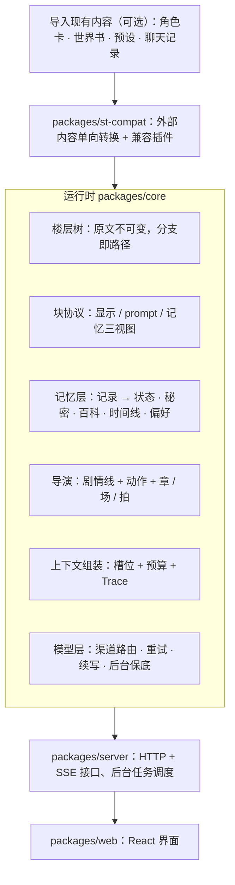

# Dramaticer

> **新一代 AI 角色扮演（AIRP）的叙事运行时。记忆管过去，导演管未来。**

Dramaticer 想回答一个问题：**当故事长到几百上千楼、世界观大到装不进上下文时，AI 角色扮演应该怎样运转？**

今天主流的做法，是把角色卡、世界书、预设、历史全部拼成一段越来越长的提示词，再寄希望于模型自己记住一切、自己推动剧情。这条路的天花板很清楚：模型忘事、串戏，剧情原地打转，玩家只能一遍遍重写。问题不在文笔，而在于**一切都被字符串化了**。

Dramaticer 提出另一种做法：**把故事当作一个有结构的系统来运行**，让程序和模型各做自己擅长的事。

## 理念

| 理念 | 意思 |
|---|---|
| **故事是一棵不可篡改的楼层树** | 每一楼原文写下就不再修改；重写、编辑、分支都是新节点。一切派生内容都能追回原文。 |
| **记忆管过去** | 后台把每一楼整理成带逐字出处的记录，再由程序投影出状态、秘密（谁知道、谁不知道）、百科与时间线。只追加、不覆盖，任何一页都能从原文重建。 |
| **导演管未来** | 剧情线、伏笔、倒计时、章与场由程序跟踪；导演只在玩家留白时给出建议，模型可以不采纳。 |
| **程序管事实与调度，模型管文笔与意图** | 不强迫模型记账、调用工具或输出固定格式；事实的写入全部经过程序校验。 |
| **间隙是免费的算力** | 回复写完到玩家下一次输入之间，后台完成记录、归档、预筛和提前备好；回合内只做必须看到玩家输入的事。 |
| **不干扰玩家，玩家可以改一切** | 玩家写了自己的行动，导演什么都不加；系统知道的每一样东西都能看、能改、能撤销，玩家的修改不会被后台覆盖。 |
| **每一轮都能解释** | 这一轮模型看到了什么、来自哪里、花了多少，都摆在玩家面前；有可量化的北极星指标，而不是凭感觉。 |

它解决的是长线 AI 角色扮演的两个根本问题：

1. **遗忘与串戏**：记不住早先的事，人物知道不该知道的事 → 由**记忆层**负责。
2. **停滞与重复**：剧情原地打转、伏笔无人回收 → 由**导演**负责。

Dramaticer 不追求更好的文笔（那是模型的事），也不追求更花哨的界面或又一种卡片格式。它要做的是 AI 叙事的**运行时**：一个可以长期、稳定、可解释地运转故事的地基。

### 关于现有生态

已经有大量社区创作的角色卡、世界书与预设。Dramaticer 可以把它们导入并转换成自己的结构，所以你不必从零开始——但**兼容只是入口，不是地基**：核心里没有任何外部格式的概念，所有兼容语义都隔离在可选的转换层与插件里（设计不变量 I1、I15）。

## 目录

- [理念](#理念)
- [当前状态](#当前状态)
- [功能一览](#功能一览)
- [核心设计](#核心设计)
- [快速开始](#快速开始)
- [配置](#配置)
- [使用指南](#使用指南)
- [命令行](#命令行)
- [开发](#开发)
- [仓库结构](#仓库结构)
- [设计不变量](#设计不变量)
- [隐私与数据](#隐私与数据)
- [文档索引](#文档索引)
- [路线](#路线)
- [许可证](#许可证)

---

## 当前状态

- **阶段**：MVP 收口中（定义见 `docs/DESIGN.md` §15.2）。功能主体已经完成，正在用真实大卡长线试玩、收集北极星指标。
- **门禁**：`pnpm check`（不变量 + 类型检查 + lint + 约 2,800 个单元测试）全绿；`pnpm e2e`（Playwright，手机与桌面两个项目，约 80 个端到端用例）全绿。
- **前端体积**：首屏 JS 约 170 KB、CSS 约 16 KB（gzip），不打包字体；预算由 `packages/web/scripts/budget.mjs` 在 e2e 前检查。
- **还没有公开发布**：没有打包好的安装程序，需要按下面的步骤从源码运行。

## 功能一览

### 写故事

- **楼层树**：每一楼都是不可修改的节点；重写（swipe）、编辑、分支都是新建兄弟节点，随时切回任意分支。
- **三种写法**（只由玩家手动切换，程序不自动换）：
  - **快速**：一次主调用，模型可以按需调用本地读取工具（软上限默认 3 轮）。
  - **规划**：程序规定的固定阶段（挑记忆 → 角色意图 → 定计划 → 写正文），可预测的阶段在间隙里提前备好。
  - **深度**：单 agent 的草稿工作区循环（起草、自查、修改、提交），故事数据呈现为文件树。
- **推进三档**：一步 / 一场 / 跳跃——玩家把方向交给系统时用。
- **行动选项**：每轮备好三四个可点的行动。
- **带原因重写**：没推进、没听我的、太短、人设不对、格式乱、别推这条线；原因写进偏好，并作为纠正带进这次重写。
- **改这句**：只重写选中的一段，并记进偏好。
- **本轮临时开关**：输入台的「本轮」面板，只对下一次发送生效（例如临时关掉检索或文风指令）。
- **开局候选**：导入卡后自动给出几种开场，选中后成为根楼层。

### 记忆层（管过去）

- **只追加的记录**：每一句事实都带楼层、故事时间、涉及实体、重要度与逐字出处；后台模型只写新记录，不改不删旧记录。
- **状态与秘密**：位置、衣着、伤势、持有物、数值由状态差异确定性投影；秘密写明谁知道、谁不知道，上下文里做知情标注。
- **百科**：人物、地点、势力、物品页面由记录与状态程序汇编，每句可追到原文。
- **时间线**：场 → 章 → 卷的摘要，只追加，每级可展开到原文。
- **融合检索**：BM25、向量（bge-m3）、实体、事件、新近度五路，按 RRF 融合；可选重排序。
- **重逢提醒**：久未出场的人物、地点被提到时，程序注入它的页面。
- **出处逐字校验**：写入的引文必须逐字出自源楼层，对不上整条拒绝。

### 导演（管未来）

- **剧情线**：谁想要什么、阻碍、倒计时；伏笔有上限，到期提醒回收。
- **八种动作**：纯程序选择，模型可以不采纳（只是建议）。
- **不干扰玩家**：默认「仅推进时」出手；玩家写了自己的行动，导演什么都不加。
- **章 / 场 / 拍**：章末清点、本场目标、节拍。
- **「这不是我要的」**：一键撤回导演的安排，那条线被静音。

### 玩家可以改一切

- 设定条目、人物设定、规则、状态、记录、百科语句、时间线、秘密、偏好、剧情线、伏笔、大纲——都能就地修改、锁定、撤销、回滚。
- 作者内容（世界书等）改的是**这个故事的副本**，可以恢复原卡。
- 玩家的修改自动锁定，后台重算不会覆盖。

### 可观测

- **上下文页**：这一轮模型实际看到了什么、每一条来自哪里，点一下跳到修改处。
- **Trace 与 `dramaticer explain`**：解释某一楼为什么这么写、为什么忘了某件事。
- **成本可见**：每轮输入 / 输出 token、缓存命中、耗时。
- **北极星指标**：每百楼带原因重写率（设置页「功能」分页底部，或 `dramaticer stats rerolls`）。
- **后台暂停提示**：后台渠道连续失败时，故事页顶部写明哪个岗位、哪个渠道、什么错误。

### 导入现有内容与扩展

- **分型导入**：世界书条目按运行时行为分成常识、人物地点、规则、数值、有条件、事件、文风、素材等；导入检查页显示每轮固定带入的前后对比。
- **四个兼容插件**：`st-content`（世界书激活语义）、`st-mvu`（变量）、`st-ejs`（模板）、`st-helper-host`（酒馆助手脚本，在沙箱 iframe 里运行）。
- **预设映射**：导入的预设能对应上的条目变成原生写作选项，其余作为文风包整体开关。
- **生图**：ComfyUI 工作流，手动或模型主动出图。
- **应用内助手**：用自然语言查设定、改配置、审阅待确认的修改。

## 核心设计



核心原则（详见 `docs/DESIGN.md` §3）：

1. **楼层原文不可变**：编辑与重写都是新节点。
2. **三视图派生**：显示、prompt、记忆都从原文派生，正则与渲染不改原文。
3. **状态按楼层存差异**：沿路径累加得出，快照只是缓存。
4. **整理过的知识都带出处**：所有写入经结算器校验。
5. **程序管事实与调度，模型管文笔与意图**：不强制模型调用工具或输出结构。
6. **间隙是免费算力**：回复落定到玩家下一次输入之间做记录、归档、预筛与提前备好。
7. **兼容只是入口**：`core` 不出现任何酒馆概念，也不依赖其他工作区包。

### 包与依赖方向

| 包 | 作用 | 依赖 |
|---|---|---|
| `packages/core` | 领域模型、存储（SQLite + sqlite-vec）、记忆、导演、上下文组装、模型层、插件内核 | 不依赖其他工作区包 |
| `packages/protocol` | server 与 web 之间的请求 / 响应类型 | core（只用类型） |
| `packages/st-compat` | 酒馆内容 → core 模型的单向转换、四个兼容插件、`dramaticer` 命令行、评测工具 | core |
| `packages/server` | HTTP 接口、SSE 流式回合、后台任务调度、静态文件 | core、protocol |
| `packages/web` | React 19 + Vite 界面（书架、故事、记忆、大纲、设定、设置） | protocol、core（只用类型与纯函数） |

## 快速开始

### 环境要求

- **Node.js ≥ 22.19**
- **pnpm 10.32**（`packageManager` 字段已固定版本；建议用 `corepack enable` 启用）
- Windows、macOS、Linux 都可以；`better-sqlite3` 与 `sqlite-vec` 会安装预编译的原生模块。
- 一个或多个模型渠道：**OpenAI 兼容接口**、Google Generative AI 或 Google Vertex。

### 1. 安装

```bash
git clone <仓库地址> dramaticer
cd dramaticer
corepack enable
pnpm install
```

### 2. 配置密钥（`.env`）

```bash
cp .env.example .env
```

按注释填写。最少需要：

| 变量 | 用途 |
|---|---|
| `DRAMATICER_MAIN_BASE_URL` / `DRAMATICER_MAIN_API_KEY` / `DRAMATICER_MAIN_MODEL` | 写正文的主模型 |
| `DRAMATICER_BG_BASE_URL` / `DRAMATICER_BG_API_KEY` / `DRAMATICER_BG_MODEL` | 后台模型（结算、记录、导演规划） |
| `DRAMATICER_BG2_*` | **建议**：另一家供应商的后台保底，主后台额度耗尽或被停用时自动切换 |
| `SILICONFLOW_API_KEY` | 可选：向量嵌入（bge-m3）与重排序 |
| `DRAMATICER_SERVER_PASSWORD` | 可选：访问密码；**绑定非本机地址时必填** |

`.env` 已被 git 忽略，密钥只在运行时读取，界面与日志都不显示密钥值。

### 3. 配置渠道（`data/channels.yaml`）

```bash
mkdir -p data
cp channels.example.yaml data/channels.yaml
cp images.example.yaml data/images.yaml   # 可选：需要 ComfyUI 生图时
```

示例配置已经包含主模型、后台模型与跨供应商的后台保底（`bg2` + `bg-fallback`）。也可以启动后在界面「设置 → 模型 → 选渠道和模型」里编辑。详见下面的[配置](#渠道channelsyaml)。

### 4. 构建并启动

```bash
pnpm build      # 构建全部包与前端
pnpm serve      # 启动服务：默认 http://127.0.0.1:8787
```

浏览器打开 <http://127.0.0.1:8787>。数据库默认在 `data/dramaticer.db`，生成的图片在 `data/images/`。

启动日志会打印渠道配置提醒，例如「后台模型没有配置保底」「保底和主模型共用渠道」。

### 5. 开玩

1. 书架上点「导入一张卡」，选择 PNG / JSON 角色卡（可以同时带世界书）。
2. 进入「导入检查」看分型结果，按需调整。
3. 回到故事页，从开局候选里选一个，或者直接写下你的开场、按「推进」。

### 前端开发模式

```bash
pnpm serve                              # 终端一：后端
pnpm --filter @dramaticer/web dev       # 终端二：Vite 开发服务器（热更新）
```

## 配置

### 渠道（`channels.yaml`）

```yaml
channels:            # 渠道：连接参数、限速、重试、超时
  bg:   { api: openai-completions, baseUrl: ${DRAMATICER_BG_BASE_URL},  apiKey: ${DRAMATICER_BG_API_KEY} }
  bg2:  { api: openai-completions, baseUrl: ${DRAMATICER_BG2_BASE_URL}, apiKey: ${DRAMATICER_BG2_API_KEY} }
  main: { api: openai-completions, baseUrl: ${DRAMATICER_MAIN_BASE_URL}, apiKey: ${DRAMATICER_MAIN_API_KEY} }

models:              # 模型别名：一个模型可以按优先级配多个渠道，前面的失败自动切换
  main:
    id: ${DRAMATICER_MAIN_MODEL}
    channels: [main]
  background:
    id: ${DRAMATICER_BG_MODEL}
    maxTokens: 32768
    channels: [bg]
    fallback: bg-fallback      # 主模型所有渠道都失败后，后台岗位改用它
  bg-fallback:
    id: ${DRAMATICER_BG2_MODEL}
    channels: [bg2]            # 走另一家供应商

roles:               # 岗位 → 模型别名
  writer: main         # 写正文
  settler: background  # 结算与抽取
  planner: background  # 导演与条件判断
  judge: background    # 评测裁判（必须与 writer 不同模型家族）
```

要点：

- `apiKey` 只能写 `${环境变量名}` 引用，不能写密钥值。
- **后台保底**（`fallback`）只对后台岗位生效；正文写作不会自动换模型，避免一段故事里混进不同模型的文风。
- 保底与主模型共用渠道时，额度耗尽会一起停；启动日志与设置页会提醒。
- 后台连续 3 条任务因渠道失败而出错时，故事页顶部显示「记忆与导演暂停了」及原因；有一条任务成功就自动消失。正文照常能写，后台恢复后会补上落下的楼层。
- 「设置 → 渠道」里可以对任意模型或任意岗位单独做**渠道体检**（流式、函数调用、思考、缓存统计），结果写回配置。
- 支持的 `api`：`openai-completions`（默认，任何 OpenAI 兼容网关都可以）、`google-generative-ai`、`google-vertex`（见 `packages/core/src/llm/channels.ts`）。Vertex 用服务账号 JSON，路径写在 `.env` 的 `GOOGLE_APPLICATION_CREDENTIALS`。

### 功能开关与档位

设置页「功能」分页：每项都能随时开关，显示每轮后台开销与起过几次作用。三个档位一键切换：

| 档位 | 适合 |
|---|---|
| **省** | 只留最必要的几项，后台调用最少 |
| **均衡**（默认） | 记忆和导演都开：场记、档案归档、检索、导演（仅推进时）、行动选项、工具查阅等 |
| **全开** | 再加上提前备好、插图和配乐 |

还没接通运行时的开关会标「尚未生效」，不会显示成已生效。与别处重复的设置（思考、原样兼容、出图）以写作页、导入方式、生图设置为准。

### 写作选项

设置页「写作」分页：文风、人称、长度、节奏、尺度、思考、替我行动；导入的预设能对应上的条目变成这里的选项。卡可以带推荐配置，你的调整叠在上面。

### 外观

设置页「写作」分页第一行：跟随系统 / 亮（纸）/ 暗（墨）。

### 服务参数

```text
dramaticer-serve [--db <路径>] [--port <端口>] [--host <地址>] [--channels <路径>]
                 [--images <路径>] [--media-dir <路径>] [--docs-root <目录>]
                 [--assistant-web-search <地址>] [--web <目录>]
```

| 参数 | 默认 |
|---|---|
| `--db` | `data/dramaticer.db` |
| `--channels` | `data/channels.yaml` |
| `--images` | `data/images.yaml`（不存在时生图关闭） |
| `--host` / `--port` | `127.0.0.1` / `8787` |

绑定非回环地址（例如 `--host 0.0.0.0`）时必须设置 `DRAMATICER_SERVER_PASSWORD`，否则拒绝启动。

## 使用指南

### 页面

| 页面 | 做什么 |
|---|---|
| **书架** | 卡面封面网格；「继续上次」突出最近的故事 |
| **故事** | 书页式正文、页边批注（手机上折叠为每楼末尾的「批注 N」）、输入台（行动选项 → 推进三档 → 自由输入 → 写法与批注开关）、停靠栏（导演 / 记忆 / 上下文；手机上是底部抽屉） |
| **记忆** | 百科、状态、秘密、时间线、偏好五个分页，全部就地可改；锁定、撤销、原文摘录 |
| **大纲** | 总纲（核心问题、基调、不要发生）→ 卷 → 关键事件；约束强弱；AI 建议逐条决定 |
| **设定** | 这个故事的设定副本：按类型筛选、停用、恢复原卡、在优化与原样之间切换 |
| **设置** | 写作 / 功能 / 模型三个分页 |
| **更多** | 旧工具面板：聊天、导入、导入检查、分支、台账、连载、导演、生图、高级设置、渠道 |

### 快捷键

- `Ctrl K`：命令面板（跳转页面、执行动作）
- 输入框里 `Enter` 发送、`Shift+Enter` 换行
- 就地编辑：`Enter` 保存、`Esc` 放弃
- 全部主流程只用键盘也能走完；系统设了「减少动效」时界面没有动画

### 重写原因与北极星指标

每次重写都可以选原因。设置页「功能」分页底部的「重写率」表按原因、按「1–10 楼 / 之后」两段给出每百楼重写次数，并把导演参与与否的干扰统计并排显示。越低说明越少需要你返工。

## 命令行

`dramaticer` 命令在 `packages/st-compat`（构建后在 `packages/st-compat/dist/cli.js`）：

```bash
pnpm --filter @dramaticer/st-compat build
node packages/st-compat/dist/cli.js <命令> ...
```

| 命令 | 作用 |
|---|---|
| `probe <channel> [--model <alias>]` | 渠道体检 |
| `chat --story <id> --user <text> [--card <path>] [--world <path>] ...` | 命令行里跑一轮（可直接带卡与世界书） |
| `work --db <path>` | 手动执行后台任务队列（结算、记录、归档等） |
| `ledger cards <story> --db <path>` / `ledger --approve\|--reject\|--rollback <id>` | 查看、批准、拒绝、回滚变更卡 |
| `open --story <id> --db <path>` | 生成、列出、选择开局候选 |
| `director plan --story <id> --db <path> [--set <file> \| --generate]` | 查看、替换或生成导演计划 |
| `actions --node <id> --db <path>` | 读取某一楼已生成的候选行动 |
| `explain --node <id> --db <path> [--json]` | 解释一楼为什么这么写（只读，不调用模型） |
| `images workflow import\|list\|show ...` | 管理 ComfyUI 生图工作流 |
| `stats rerolls --db <path> [--story <id>] [--json]` | 每百楼带原因重写率（只读，只输出数字） |

`packages/st-compat/package.json` 里还有评测、回放、对照、试玩等脚本（`pnpm --filter @dramaticer/st-compat run <脚本>`），它们只在评测时使用。

## 开发

### 常用命令

| 命令 | 作用 |
|---|---|
| `pnpm check` | **门禁**：不变量检查 → 类型检查 → biome lint → vitest 全部单元测试 |
| `pnpm e2e` | 构建 server 与 web → 体积预算检查 → Playwright（手机 390px 与桌面 1440px 两个项目） |
| `pnpm test` | 只跑单元测试 |
| `pnpm lint` | biome 检查（`pnpm exec biome check --write .` 自动修格式） |
| `pnpm typecheck` | `tsc -b` + web 类型检查 |
| `pnpm build` | 构建全部包与前端 |
| `pnpm invariants` | 只跑设计不变量检查 |
| `pnpm exec vitest run <文件>` | 跑单个测试文件 |

改了 `core` 的导出后，server 读的是 core 的 `dist`：先 `pnpm --filter @dramaticer/core run build`。单独跑某个 e2e 文件前先构建前端（Playwright 用的是 `packages/web/dist`）。

### 技术栈

TypeScript strict、ESM、Node ≥ 22.19、pnpm workspace；vitest；biome；better-sqlite3 + sqlite-vec；React 19 + React Router 7 + Vite；Playwright。新增运行时依赖必须登记在 `docs/dev/DEPENDENCIES.md`（门禁会查）。

### 测试约定

- 单元测试只用合成数据（`packages/*/test/fixtures/`），**不访问网络**；需要真实模型的测试放进 `*.live.test.ts`，默认跳过。
- e2e 用 `packages/web/e2e/fake-channel.mjs` 这个假模型渠道，完全离线。
- 私有数据（`eval-private/`、`data/`）永远不能进入测试数据、提交或日志。

### 开发协议（给人和 agent）

项目的全部开发规则在 [`AGENTS.md`](AGENTS.md)：会话协议、设计不变量、安全红线、工程规范。要点：

- 工作以「规格 + 工单」组织，在 `.scratch/<功能>/spec.md` 与 `issues/NN-*.md`；总览与推荐顺序在 `.scratch/README.md`。
- 每次会话从 `docs/dev/HANDOFF.md` 读起，结束时重写它；长期注意事项在 `docs/dev/NOTES.md`。
- 改变设计、不变量或对外格式时，在 `docs/dev/DECISIONS.md` 追加一条 ADR。
- 需要人类处理的事写进 `docs/dev/HUMAN.md`；新需求写进 `docs/dev/INBOX.md`。
- 名字一律按 [`GLOSSARY.md`](GLOSSARY.md)（界面、文档、工单统一用语）。
- 自动开发循环：`tools/devloop/devloop.ps1`（人工开发前先新建 `.devloop/STOP` 停掉循环）。

### 代码风格

标识符用英文，文档与注释用中文；注释只写「为什么」。界面文字一律中文。

## 仓库结构

```text
.
├── AGENTS.md                 # 开发协议（会话流程、不变量、安全红线）
├── GLOSSARY.md               # 命名表
├── channels.example.yaml     # 渠道配置示例
├── images.example.yaml       # 生图配置示例
├── .env.example              # 环境变量示例
├── packages/
│   ├── core/src/
│   │   ├── store/            # 存储：story-store.ts 是外观，repos/ 下按领域分 15 个仓储
│   │   ├── memory/           # 记录、抽取、百科汇编、检索
│   │   ├── director/         # 剧情线、动作、章 / 场 / 拍、开局
│   │   ├── context/          # 上下文模板、组装、上下文包
│   │   ├── chat/             # 回合（快速 / 规划 / 深度）、槽位提供者
│   │   ├── llm/              # 渠道配置、路由、重试、续写、后台保底
│   │   ├── ledger/           # 台账、结算器、场记
│   │   ├── blueprint/        # 大纲
│   │   ├── background/       # 后台任务队列、调度、健康状态
│   │   ├── plugins/          # 插件内核、后台任务插件、槽位插件
│   │   ├── settings/         # 功能开关与档位
│   │   ├── preferences/      # 偏好、重写原因、北极星指标
│   │   └── ...
│   ├── protocol/             # server ↔ web 的类型
│   ├── st-compat/src/
│   │   ├── st-content/ st-mvu/ st-ejs/ st-helper-host/   # 四个兼容插件
│   │   ├── st-bench/         # 兼容插件的一致性验收台
│   │   ├── evalset/          # 评测与回放工具
│   │   └── cli.ts            # dramaticer 命令行
│   ├── server/src/
│   │   ├── routes.ts         # 分发入口
│   │   ├── routes-*.ts       # 按领域拆分的处理函数；routes-common.ts 是共用校验
│   │   ├── turns.ts          # SSE 流式回合
│   │   ├── background.ts     # 后台任务调度
│   │   └── runtime.ts        # 每个故事的运行时（模型客户端、槽位）
│   └── web/
│       ├── src/v4/           # 新界面：书架、故事、记忆、大纲、设定、设置、旧工具面板
│       ├── src/v4/v4.css     # 「纸与墨」设计系统
│       ├── e2e/              # Playwright 用例与假模型渠道
│       └── scripts/budget.mjs# 前端体积预算
├── docs/
│   ├── DESIGN.md             # 设计的唯一权威（v1.0）
│   ├── dev/                  # HANDOFF、NOTES、DECISIONS（ADR）、HUMAN、INBOX、DEPENDENCIES
│   ├── plugins/              # 插件文档
│   ├── proposals/            # 历史提案（背景资料）
│   └── archive/              # 旧版设计稿
├── scripts/check-invariants.mjs   # 不变量检查（门禁的一部分）
└── tools/devloop/            # 自动开发循环
```

## 设计不变量

来自 `docs/DESIGN.md`，任何改动都不得违反。标 🔒 的由 `scripts/check-invariants.mjs` 在门禁里机器检查。

| # | 不变量 |
|---|---|
| I1 🔒 | `core` 不依赖 `st-compat`，也不出现酒馆概念 |
| I2 🔒 | 私有数据（`eval-private/`、`data/`、`.env`）不能被 git 跟踪 |
| I3 🔒 | 每个运行时依赖都在 `docs/dev/DEPENDENCIES.md` 登记 |
| I4 | 楼层原文不可修改；swipe 与编辑都是新建节点 |
| I5 | 状态按楼层存差异，快照只是缓存 |
| I6 | 三种写法只能由玩家手动切换 |
| I7 | 不做多 agent 来回讨论；固定阶段有上限并写入 Trace |
| I8 | 显示、prompt、记忆三视图从原文派生 |
| I9 | 导演的实时选择用纯程序实现，只给建议 |
| I10 🔒 | 单元测试不访问网络、不用私有数据 |
| I11 | 能在间隙做的工作不放进回合内 |
| I12 | 台账是唯一的事实来源，所有写入经结算器校验 |
| I13 | 尊重模型能动性：不强制工具调用或固定结构 |
| I14 | 玩家本地酒馆的额度属于玩家 |
| I15 🔒 | 兼容只是入口：core 不依赖任何其他工作区包 |
| I16 | 插件不能修改楼层原文，写入经结算器 |
| I17 | 回合内插件钩子有时间预算，超时跳过并写入 Trace |
| I18 | 代码插件的权限必须声明并在安装时展示 |

## 隐私与数据

- **全部数据在本机**：故事库是一个 SQLite 文件（`data/dramaticer.db`），没有遥测，不连接除你配置的模型渠道以外的任何服务。
- **密钥只在 `.env`**：配置文件里只写环境变量名；渠道接口、日志、后台错误摘要都不显示密钥值。
- `data/`、`eval-private/`、`.env` 已被 git 忽略，并由门禁检查不会被跟踪。
- 写给仓库的评测报告只包含统计数字，不包含对话原文。

## 文档索引

| 文档 | 内容 |
|---|---|
| [`docs/DESIGN.md`](docs/DESIGN.md) | 设计的唯一权威：记忆层、导演、上下文、模型层、插件、界面 |
| [`AGENTS.md`](AGENTS.md) | 开发协议与不变量 |
| [`GLOSSARY.md`](GLOSSARY.md) | 命名表 |
| [`docs/dev/HANDOFF.md`](docs/dev/HANDOFF.md) | 最近一次开发会话的交接 |
| [`docs/dev/NOTES.md`](docs/dev/NOTES.md) | 按模块整理的注意事项与可重复命令 |
| [`docs/dev/DECISIONS.md`](docs/dev/DECISIONS.md) | 架构决策记录（ADR） |
| [`docs/dev/DEPENDENCIES.md`](docs/dev/DEPENDENCIES.md) | 运行时依赖登记 |
| [`.scratch/README.md`](.scratch/README.md) | 规格与工单总览 |
| [`docs/plugins/`](docs/plugins/) | 插件文档 |

## 路线

1. **MVP 收口**（进行中）：真实大卡连续试玩 2–3 个故事，拿到北极星指标的真实数字。
2. **工程整理**（大部分完成）：存储层与路由已按领域拆分；未胜出的实验候选已删除（v3 的机制序列在有数据前暂留）；评测工具独立成包暂缓。
3. **之后**：公开 alpha → 公开合成基准 → Tauri 打包 → 生图第二批（NovelAI、Grok、OpenAI 兼容图像）→ 声明式插件格式与代码插件权限 → 插件市场。

明确不做：程序自动切换写法、多 agent 来回讨论、强制每轮工具调用、为兼容酒馆扭曲核心设计、每楼存状态快照、用知识图谱做存储、默认调用玩家本地酒馆的额度（详见 `docs/DESIGN.md` §16）。

## 许可证

尚未选定开源许可证；在仓库加入 `LICENSE` 文件之前，保留所有权利。兼容插件按公开文档描述的行为独立实现，没有复制上游源码（见 `docs/dev/HUMAN.md` 的 HUMAN-17、HUMAN-18）。
