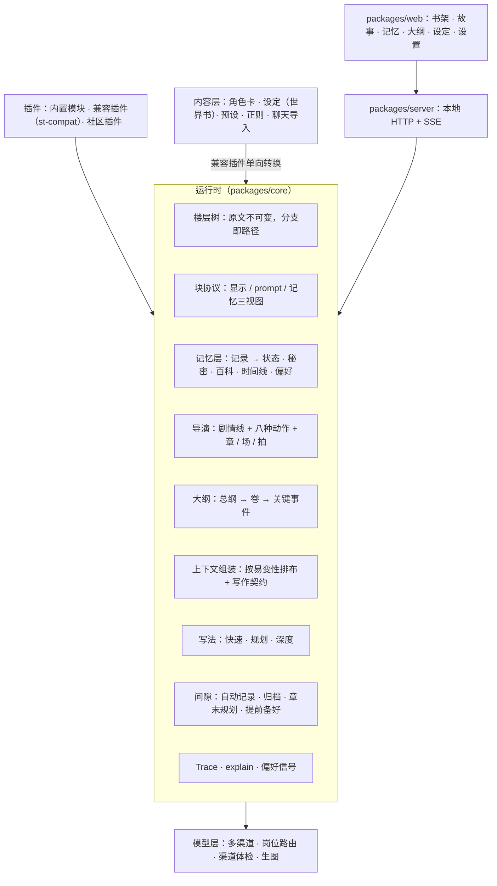

# Dramaticer 总设计案 v1.0

> 2026-11-19 重写。本文只描述**现在的设计与实现**，是「做什么」的唯一权威；名字一律按根目录 `GLOSSARY.md`。
> 历史版本：`docs/archive/DESIGN-v0.4.md`（v2–v4 逐层叠加的旧稿，含全部数据依据与历史决定）。提案 `docs/proposals/v4.md` 及更早的提案已经全部并入本文，只作背景资料，与本文冲突时以本文为准。
> 章节编号沿用旧稿，代码注释里的「DESIGN §N」仍然有效。

## 0. 一句话

**Dramaticer 是新一代 AI 角色扮演（AIRP）的叙事运行时：把故事当作有结构的系统来运行，程序管事实与调度，模型管文笔与意图。记忆管过去，导演管未来。** 现有生态的角色卡、世界书与预设可以导入，但兼容只是入口，不是地基（I15）。

## 1. 定位与目标

- **定位**：开源社区项目，目标是成为 AIRP 新一代运行时的标杆，不是又一个酒馆前端。
- **主场景**：大型角色卡的长线剧情（世界观大、角色多、几百到上千楼）。
- **两个根本问题**：
  1. **遗忘与串戏**：AI 记不住早先的事，人物知道不该知道的事。由记忆层负责（§7）。
  2. **停滞与重复**：剧情原地打转、伏笔无人回收。由导演负责（§8）。
- **另一条主线：不干扰玩家**。导演只填玩家留下的空白；玩家能看到、修改、撤销系统知道的一切（楼层原文除外）。
- **不追求**：更好的文笔（模型的事）、更花哨的界面、新的卡片或预设格式。

## 2. 诊断（数据依据摘要）

完整数字见旧稿 §2 与 `docs/proposals/v4.md` 第一节。要点：

| 事实 | 数字 | 结论 |
|---|---|---|
| 卡的内容就是世界书 | 68 张卡里 63 张内嵌世界书；每本中位数 70 条，每轮常驻约 2.8 万字符 | 导入要按条目的运行时行为分型 |
| 世界书近一半是程序 | 变量与更新规则 24.0%，EJS 23.6%（九成是条件判断） | 条件设定要有原生表示 |
| 模型近一半输出在记账 | 45% 带变量更新，45% 带总结 | 记账移到后台，正文只写故事 |
| 玩家近五分之一的输入是「推进」 | 约 18%；给出选项后 83% 的回复不超过 40 字符 | 系统要供给方向，也要能提前备好 |
| 重 roll 主因 | 不推进 19.3%、没听指示 18.2%、格式 13.7%、截断 13.0%、遗忘 5.6% | 推进与听话是第一优先 |
| 开局最难 | 1–10 楼重 roll 率 24.9%，之后 7–10% | 开局属于主菜 |

**病根：一切都被字符串化了。** 回答是把运行时结构化，同时保持对内容的兼容。

## 3. 核心原则

1. **楼层树，原文不可变**：楼层节点只新建不修改；swipe、重写、编辑都是兄弟节点（I4）。
2. **三视图派生**：显示、prompt、记忆三种视图都从原文派生，正则与渲染不改原文（I8）。
3. **状态按楼层存差异**：沿路径累加得出，快照只是缓存（I5）。
4. **整理过的知识都带出处**：记录、状态、秘密、百科都能追到原文的逐字引文；写入全部经过结算器校验（I12）。
5. **程序管事实与调度，模型管文笔与意图**：不强制模型调用工具或输出结构（I13）；导演的实时选择是纯程序（I9）。
6. **间隙是免费算力**：回复落定到玩家下一次输入之间做自动记录、归档、预筛与提前备好；回合内只做必须看到玩家输入的事（I11）。
7. **三种写法，玩家手动选**：快速、规划、深度，程序不自动切换（I6）。
8. **被动注入保底，工具补充**：模型不会去搜它不知道自己忘了的东西。
9. **兼容只是入口**：`core` 不出现酒馆概念、不依赖其他工作区包；酒馆语义只在兼容插件里（I1、I15）。
10. **玩家可以改一切**：除原文外每一项都能看、能改、能撤销；玩家的修改自动锁定，后台不得覆盖（§15 旧稿的「一切可改」，现为 §7.6）。
11. **可观测、可评测**：每一轮都能回看（Trace、`dramaticer explain`、上下文页）；每轮成本对玩家可见；没有赢过基线不算完成。

## 4. 总体架构

### 4.1 包与边界

| 包 | 职责 | 依赖 |
|---|---|---|
| `core` | 领域模型、存储（SQLite + FTS5 + sqlite-vec）、记忆、导演、上下文、写法、LLM 接口、插件内核 | 不依赖任何其他工作区包 |
| `protocol` | server 与 web 共用的 HTTP、SSE 类型与常量 | 无 |
| `st-compat` | 酒馆内容到原生模型的单向转换；四个兼容插件 `st-content`、`st-mvu`、`st-ejs`、`st-helper-host`；`dramaticer` CLI；**目前也承载评测工具**（`evalset/`、`st-bench/`，见 §15.3） | `core` |
| `server` | `node:http` 本地服务、SSE 回合、后台调度、应用内助手 | `core`、`protocol`、`st-compat` |
| `web` | React + Vite，移动端优先，中文优先 | `protocol` |

## 5. 楼层树

| 字段 | 说明 |
|---|---|
| raw | 原始文本，永不修改；存储层没有更新 `raw` 的接口 |
| blocks | 块解析结果（缓存，可重建） |
| 状态差异 | 本楼产生的状态写入，带来源与出处 |
| trace | 本轮完整请求记录：上下文各段来源与 token、裁剪、检索名次、导演决策、缓存命中 |

- swipe、重写、改这句、编辑都新建兄弟节点。
- **场次**是楼层路径上的派生区间，不是存储节点；边界由自动记录判定，12 楼兜底；切换分支后按当前路径重算。
- 摘要、归档、百科只在其覆盖的楼层都在当前路径上时有效。

## 6. 块协议

- 增量解析 `<thinking>`、`<选项>`、`<页眉>` 等标签块，支持流式（已闭合 / 未闭合）。
- 每种块有三套策略：**显示**（原生组件或沙箱 iframe）、**上下文**（保留 / 删除 / 保留到深度 N）、**语义映射**（写入记忆或状态）。
- **prompt 视图**：显示类块（状态栏、变量更新、分析、选项、图片）在历史里省略，最近一楼保留原文；开关关闭时与原文逐字节一致。
- **输出只要正文**：状态栏、选项、变量更新由程序按状态渲染或由后台完成，不要求模型输出；卡自带的这类输出按块策略处理。
- 酒馆正则分三层：原样执行（兼容插件）、自动升级为块策略、原生块类型。

## 7. 记忆层（管过去）

### 7.1 三层

| 层 | 内容 | 性质 |
|---|---|---|
| 原文 | 全部楼层 | 唯一的真相，不可改 |
| 整理过的知识 | 记录、状态、秘密、百科、时间线、偏好 | 都带原文出处，可改、可重建 |
| 上下文 | 这一轮实际带入的部分 | 每轮按规则组装，玩家在「上下文」页看得见 |

### 7.2 整理过的知识

| 名字 | 做法 | 存储 |
|---|---|---|
| 记录 | **只追加**的一句事实或事件：楼层、故事时间、涉及实体、重要度、逐字出处。后台模型只写新记录，不改不删旧记录；新旧说法都保留，读取时按故事时间解决 | `memory_events` + `memory_event_quotes`；被拒的写入进 `memory_rejections` |
| 状态 | 位置、衣着、伤势、持有物、时间、卡定义的数值；由程序从状态差异按键取最新值，是确定性投影 | `state_diffs`（台账路径，见旧稿 §7.1 的路径表） |
| 秘密 | 是什么、谁知道、谁不知道；在场即知道，转述、偷听、书信由自动记录显式标出 | 由记录与场次推导 |
| 百科 | 人物、地点、势力、物品、剧情线的页面，**由该实体的全部记录与状态程序汇编**（`compileWikiPages`），不是模型直接改写的对象；语句带出处与有效范围 | 派生；玩家的就地修改另存并锁定 |
| 时间线 | 场 → 章 → 卷的摘要，只追加，每级可展开到原文 | 场次归档、章节摘要 |
| 偏好 | 玩家的偏好、底线、纠正，以及重写时选的原因 | 状态命名空间 `userWill` + `preference_events` |

**反思**：每章结束做一次（谁变了、哪段关系变了），结果作为带出处的记录追加（`appendReflectionRecord`），不覆盖已有记录。

### 7.3 写入（全部在间隙）

| 时机 | 工作 | 后台任务 |
|---|---|---|
| 每楼 | **自动记录**：一次小调用，追加记录、状态变化、在场者、节拍标签，判断这一场是否结束 | `scene_log` |
| 每场结束 | 场次归档：摘要、在场者、开收的伏笔；更新秘密与人物页 | `scene_archive` |
| 每章结束 | 章节摘要、反思、重新汇编涉及实体的百科、章末规划（§8） | `chapter_plan` 等 |
| 玩家纠正或带原因重写 | 写入偏好 | 同步写入 |
| 其他 | 结算补写与修复、事件抽取、嵌入、世界书预筛、压缩 | `settle`、`events`、`embeddings`、`lore_prefilter`、`compression` 等 |

- **开关**：自动记录与场次归档跟随功能页的「场记」「档案归档」（标准档默认开）；旧设置 `sceneLogEnabled` 仍可强制打开（ADR-0161）。
- **出处逐字校验**：每条记录与状态写入的 `sourceQuote` 必须逐字出自源楼层，对不上整条拒绝并记原因。
- **按需付费**：故事还放得下上下文时不做场次归档与章节汇编。
- 「合并调用」`gap_pass`（一次调用做结算、现场分析、用户意志、小品判断）在对照里结算一致率偏低（ADR-0055），默认关闭。

### 7.4 读取（按这个顺序进上下文）

1. 偏好、故事索引、时间线（稳定，利于前缀缓存）。
2. 尽可能长的原文窗口。
3. 状态、秘密（知情标注：写明「某某不在场、不知情」，写作模型仍知道全部真相）。
4. 在场人物与当前地点的百科页；**重逢提醒**：久未出场的人物、地点、物品被提到或被安排登场时，程序按名字与别名注入它的页面。
5. 一次**融合检索**：BM25、向量（bge-m3）、实体、事件、新近度五路，按 RRF 融合（默认权重 BM25 2、向量 1、实体 0.5、事件 0.5、新近 1，ADR-0084）；实体这一路由在场者与玩家提到的名字驱动；结果按故事时间排新旧；可选重排序（默认关闭）。
6. 规划与深度两种写法下，记忆另外呈现为文件树，配读、搜、写、打补丁工具。

读取时不调用模型。每一项都进 Trace 的 `context.entries[].items`，在「上下文」页可点击跳转到来源修改。

### 7.5 防错

出处逐字校验；矛盾不覆盖，进变更卡交给玩家裁决；玩家的修改是来源 `player`、优先级最高的记录并自动锁定；任何一页可从原文重建。

### 7.6 玩家可以改一切

| 类别 | 包含 | 编辑语义 |
|---|---|---|
| 作者内容 | 设定条目、人物设定、规则、写作、作者选项、素材 | 改的是**这个故事的副本**；可恢复原卡、存回卡库、导出成新卡 |
| 系统记下的 | 状态、记录、百科语句、时间线、秘密、偏好 | 直接改，校验后立即生效；自动锁定，重算不得覆盖；有历史与回滚 |
| 规划 | 剧情线、伏笔、本场目标、大纲、下一章方向 | 直接改；带出处与锁定，可回滚 |

- 玩家的修改不走变更卡；**AI 提出的修改才走变更卡**（`pending` → `approved` / `rejected` / `rolled_back`）。
- 修改挂在当前楼层上沿路径累加，切换分支得到各自的版本。删除是停用，可恢复。

### 7.7 参考与取舍

借鉴做法，不引入依赖：

| 来源 | 借鉴了什么 | 没有采用什么 |
|---|---|---|
| Mem0（2026-04 新算法） | 只追加不更新、实体做索引、多路融合检索、按时间解决新旧 | 外部记忆服务；让模型做 UPDATE / DELETE |
| LLM Wiki 模式 | 原文 → 可读的实体页面 → 查询时先读页面；页面互相链接、可整体重建 | **由模型直接维护页面**：这里的百科由程序从记录汇编，模型只写记录（X1 里模型维护档案的 `wiki` 候选矛盾率更高，ADR-0130） |
| LongMemEval | 整理出的事实当索引、取回原文；五类记忆题 | — |
| Letta / 生成式智能体 | 常驻核心记忆、后台整理；重要度与章末反思 | 写作模型在回合内自己管理记忆 |
| Zep | 变化不覆盖、按时间有效 | 知识图谱存储（X1 的 `temporal_graph` 候选未胜出） |

## 8. 导演（管未来）

原则：**导演只填补玩家留下的空白，不覆盖玩家的选择。**

### 8.1 剧情线

谁想要什么、阻碍与代价、倒计时（按故事时间推进）、后台预备的两三种发展、冷热。种类：主线问题、人物关系、对手的图谋、伏笔与约定。来源：卡里的章节舞台与动态事件、自动记录识别的承诺、助手的参谋技能、玩家在导演台新增。玩家可置顶、静音、新增、锁定。

### 8.2 三个时间尺度

| 尺度 | 何时 | 用什么 | 产出 |
|---|---|---|---|
| 章 | 章节结束 | 一次后台调用（可配更强的模型） | 清点剧情线与伏笔：收掉、作废、新开；按玩家行动重排；下一章方向 |
| 场 | 新场景开始 | 并入自动记录 | 本场目标 |
| 拍 | 每一轮 | 纯程序，零调用 | 选一个动作 |

### 8.3 八种动作（程序选择）

不干预 · 顺势 · 加阻碍 · 突发 · 收伏笔 · 揭秘 · 缓一缓 · 换场。同一动作不连用三次；理由写进 Trace。注入时写成世界里的事实加人物意图，附「玩家行动优先，你可以按剧情需要调整」。

### 8.4 不干扰玩家

- **看内容不看字数**：玩家输入分三类——推进（按钮或固定说法）、点了行动选项、其他自由输入。只有推进时导演才出手。
- **不干预就是什么都不注入**。
- **突发要等**：玩家在自己写时延后到下一次推进或场次结束；只有标记为必须打断的事件可以打断，每场最多一次。
- **节奏由玩家定**：「过于顺利」只在推进时作为加阻碍的依据。
- **玩家的行动改写剧情线**；大纲走偏时默认是大纲跟着改。
- **可见、可撤**：批注里每条导演安排带「这不是我要的」：撤回、记入偏好、静音对应剧情线。
- **默认值**：导演「仅推进时」；大纲约束「弱」。
- **指标**：重写原因里「没听我的」「别推这条线」的比例，导演开启时不得高于关闭时。

### 8.5 推进三档与伏笔

一步（当前场景顺势或加阻碍）· 一场（让这一场达成目标并换场）· 跳跃（跳到下一个倒计时到点的时刻）。伏笔上限默认 5，越老越优先收。

### 8.6 开局

开局包（地点、时间、在场者各自想要什么、第一个冲突、三个开场方向）与首楼 2–3 个候选都在玩家首次输入之前于后台完成；前 10 楼导演强度更高。

### 8.7 引擎

故事设置 `directorOrganization` 取 `lines`（v4 线与动作，**新故事默认**，ADR-0161）、`mechanisms`（v3 方案与序列）、`bits`（剧情小品）。后两者是 X2 的实验候选，只为已有故事与评测保留，计划删除（§15.3）。

## 9. 上下文组装

- **原生模板**：有序段落，可以是静态文本、条件段或 harness 槽位（character、persona、lore、state、summary、memory、history、scene、profile、reunion、scene_card、blueprint、director、user_will、protocol）。
- **按易变性排布**（`contextLayout: volatility`，默认）：卡与常驻设定 → 只追加的章节档案 → 历史原文 → 每轮变化的槽位 → 玩家消息 → 写作契约。`full` 保留旧顺序用于对照。
- **写作契约**（`protocol` 段）永远是最后一段：玩家输入是本轮指引而非已发生的剧情；其他角色可以拒绝玩家；每轮都有剧情意义；遵守偏好。
- **预算**：取舍顺序 偏好 > 人物关系 > 未收伏笔 > 当前设定 > 历史细节 > 现场描写；预算只防失控，不压缩思考。
- **缓存与成本**：渠道体检检测缓存透传；Trace 记录缓存命中 token；输入区下方显示每轮成本。
- **上下文包复用**：同一玩家楼层的检索、预筛与现场分析缓存；swipe 与重写直接复用。

## 10. 模型层

### 10.1 三种写法

| 写法 | 做法 | 上限 |
|---|---|---|
| 快速（默认） | 一次主调用；模型可按需调用读取工具 | 读取工具软上限 3 轮 |
| 规划 | 程序规定的固定阶段：状态整理 → 挑记忆与规则 → 角色各自出招 → 本轮计划 → 正文 → 复查（可选）。能预测的输入（推进三档、每个行动选项）在间隙里**提前备好**，命中时回合内只剩正文 | 阶段数固定，写入 Trace；复查不阻塞显示，结果存成兄弟版本 |
| 深度 | 单 agent 草稿工作区循环：起草 → 自查（清单由程序给出）→ 修改 → 交稿。故事数据呈现为文件树，文风与规则作为技能 | 只设防失控上限（默认 40 次工具调用或 10 分钟，可配置） |

- 只能由玩家手动切换（单轮或整个故事）；界面可以按渠道体检给出推荐；卡的推荐配置不替玩家切写法（I6）。
- 模型不按规划或深度的流程走、直接输出正文时，照样接住并成为楼层（I13）。
- 不做多个 agent 之间的来回讨论（I7）。
- 现状：深度写法在真实渠道上首轮会用草稿工具，之后多数直接写正文；写法对照（turn-modes/04）的真实批次尚未运行。

### 10.2 渠道与可靠性

- **接口类型**：`openai-completions`（各类公益站与中转，优先）、`google-generative-ai`、`google-vertex`。Vertex 走 pi-ai 的适配器，支持服务账号 / ADC（项目与区域从 `.env` 读取）和 API key（Express 模式）两种认证；尚未经过真实渠道验证。
- **pi-ai**（MIT）锁死版本，外包一层 `core/llm` 接口；`pi-agent-core` 不进入运行时。
- **多渠道**：同一模型可配多个渠道，按优先级自动切换；Trace 记录实际使用的渠道。
- **岗位路由**（`data/channels.yaml` 的 `roles`）：`writer`、`settler`、`planner`、`judge` 各自配置；缺省回落到 `main` 或 `background`。裁判与写作必须是不同模型家族，否则启动失败。
- **渠道体检**：真假流式、函数调用、思考、预填充、缓存统计；不支持函数调用时工具走文本协议（`<tool name="…">{json}</tool>`）。
- **可靠性**：截断检测（以 length 结束、标签未闭合、正文中断）、abort 后续写、重试、切换渠道。`maxTokens` 默认 `min(4096, 模型上限)`。
- **后台与正文分渠道**，避免互相抢限流；后台渠道的回退别名必须指向**另一个供应商**，否则额度耗尽时没有保底。
- 模型名一律当任意字符串透传。

### 10.3 应用内助手

一个助手，多个技能：排障（读 Trace 解释「为什么这么写、为什么忘了」）、记忆修订、参谋、资料员、卡片工坊、设置向导、使用指南。与正剧隔离：不写楼层，不进剧情上下文；复用深度写法的运行时。影响剧情的修改一律走变更卡。命令行版排障：`dramaticer explain --node <id>`（只读、零模型调用）。

## 11. 工具与结构化输出

| 类别 | 工具 | 时机 |
|---|---|---|
| 读取 | `memory_search`、`ledger_read`、`lore_lookup`、`state_get` | 快速写法按需 |
| 草稿工作区 | `file_read`、`file_search`、`file_write`、`file_patch`、`draft_write`、`commit_draft` | 深度写法 |
| 写入（可选） | `state_update`、`plot_note` | 正文之后同一回复里，不增加往返 |
| 规则 | d20 检定（卡在 `extensions.dramaticer.rules` 声明时开放） | 按用途开放 |
| 生图 | `illustrate` | 登记后由后台生成 |

模型可以不调用任何工具；写入工具只收集不执行，全部经过结算器（I12）。函数调用与文本标签共用同一套 schema 校验。

## 12. 生图

`illustrate(scene_spec)` → 读角色视觉档案与当前状态编译提示词 → 异步队列（回合内只登记，间隙里每次最多两张）→ 结果挂到楼层。后端有 ComfyUI（`data/images.yaml`，导入 API 格式 workflow）与 NovelAI（`api: novelai`，模板保存模型、尺寸、步数等参数，ADR-0167）；两者都还没有真实验收。卡面图作为故事封面，素材表的人物立绘显示在人物页；没有图的卡用占位图。

## 13. 技术栈与工程

- TypeScript strict、ESM、Node ≥ 22.19、pnpm workspace；vitest；biome；better-sqlite3 + FTS5 + sqlite-vec。
- 数据目录默认 `data/`；默认只监听 127.0.0.1，局域网访问必须设密码；API key 只在服务端。
- 门禁 `pnpm check`：类型检查、biome、不变量脚本、单元测试（评测类测试单独用 `pnpm test:eval`），CI 在 GitHub Actions 上同样执行；端到端 `pnpm e2e`（Playwright）。
- 协议 MIT。以后用 Tauri 打包桌面与移动端。

## 14. 评测与成功标准

### 14.1 北极星指标

**每百楼带原因重写率**，按原因（没推进、没听我的、太短、人设不对、格式乱、别推这条线）分开统计。它来自玩家的真实操作，不需要裁判；基线是 F0 的酒馆数据（1–10 楼 24.9%，之后 7–10%）。

### 14.2 辅助指标

| 指标 | 测法 |
|---|---|
| 矛盾率、编造回忆率 | 长程自动试玩里插入回忆探针，裁判对照状态判断；五类记忆题（LongMemEval） |
| 上下文充分性 | 评测题的答案是否出现在这一轮组装好的上下文里（程序可判） |
| 盲测胜率 | 两两对比，交换顺序各判一次，Wilson 95% 区间 |
| 重复度、推进度、伏笔兑现率 | 文本统计（字符 4-gram）加裁判 |
| 首字延迟、每轮成本 | 分写法统计 |

### 14.3 基线与规则

- **B0 朴素模式**（卡 + 预设 + 最近 N 楼）；**B1 历史回放**（同一分支点和玩家当年在酒馆的真实回复比，零额度，主力）；**B2 本地酒馆实测**需在 HUMAN.md 申请，单次最多 60 次生成（I14）。
- 裁判先过 G0（A/A 检验与真人标注配对），未过时结论记「仪器无效」。
- 门槛在运行前写进 `docs/dev/R6-PREREG.md`（v2），运行期间不改；没赢过基线就改进并重评，最多三轮，之后写进 HUMAN.md。
- 只用合成数据做单元测试；私有数据只出统计数字，不出原文（I2、I10）。

### 14.4 现状

R6 效果门槛**尚未通过**：仪器已就位，耗额度的整批对比因后台渠道额度（HUMAN-19）没有跑完。已有参考数字：X1 状态探针矛盾率 39.2%；X2 剧情小品盲测胜率 70.7% 但主要指标未达「不劣于」；B1 小样本（各 3 个）只作参考。

## 15. 路线

### 15.1 已完成

楼层树与块协议、记忆层（只追加记录、状态与秘密投影、按在场检索、百科汇编与反思、偏好、上下文来源）、导演（剧情线、八种动作、不干扰玩家、章末清点、开局）、大纲、一切可改、三种写法与提前备好、写作选项与预设映射、卡推荐配置与故事固定版本、分型导入与导入检查、规则层、生图第一批代码、插件内核与四个兼容插件、应用内助手、新界面（书架、故事、记忆、大纲、设定、设置、命令面板、手机端）。

### 15.2 MVP

**MVP 的定义**：一个玩家能用自己的渠道，导入一张真实的大卡，玩到 100 楼以上，并且：

1. 一分钟开玩：导入卡 → 选渠道 → 开局候选。
2. 默认设置下记忆层与导演真的在工作（功能页显示的就是实际运行的）。
3. 推进、行动选项、带原因重写、改这句都可用，原因进入偏好。
4. 记忆页、大纲页、设定页能看能改，上下文页能解释每一轮。
5. 每轮成本可见；后台渠道失败时有另一家供应商保底。
6. 北极星指标有一份真实数字（作者本人连续试玩 2–3 个故事）。

MVP 之前的工作只做让上面六条成立的事；其余进 §15.3 或 §18。

### 15.3 MVP 之后的工程整理

见 `.scratch/refactor/`。2026-11-19 进度：`StoryStore` 已按领域拆成 `store/repos/`、server 路由已拆成 `routes-<领域>.ts`；X1 的 `wiki`、`temporal_graph` 与 X2 的 `bits` 已删除（ADR-0166），v3 的 `mechanisms` 在北极星数据出来前暂留；功能开关已全部接通或标「尚未生效」（ADR-0163、0164）；后台跨供应商保底已实现（ADR-0165）。评测工具移到 `packages/eval` 暂缓。

### 15.4 再之后

公开 alpha（先于插件市场与生图第二批）→ 公开合成基准 → Tauri 打包 → 生图第二批（Grok、OpenAI 兼容图像）→ 声明式插件格式与代码插件权限 → 插件市场。

## 16. 明确不做

- 程序自动切换写法（I6）；多个 agent 来回讨论（I7）。
- 强制主模型每轮调用工具或输出固定结构（I13）；每轮实时让模型审核模型（复查是可选阶段且不阻塞显示）。
- 为了兼容酒馆扭曲核心设计；在核心里模拟酒馆内部 API（酒馆助手脚本只在 `st-helper-host` 的沙箱 iframe 里）。
- 每楼存状态快照；依赖外部记忆服务；用知识图谱做存储；让后台模型更新或删除旧记录。
- 默认调用玩家的本地酒馆额度（I14）。

## 17. 待验证

- 场次边界的判定是否可靠；按在场推导知情在转述、偷听场景下的覆盖率。
- 记录数量随楼层增长后的检索噪声；倒叙与回忆场景下按时间取用是否取错。
- flash 级模型汇编百科、生成剧情线与反思的质量；反思是否产生无依据的结论。
- 八种动作的触发权重（靠真人游玩与重写原因校准）。
- 规划写法相对快速写法、深度写法相对快速写法的增益（写法对照）。
- 公益站与中转渠道是否透传缓存；Vertex 渠道的真实可用性。

## 18. 暂缓

MCP 客户端与对外 MCP Server；技能包互通；面板工坊；开玩向导与导入时的外部资源预检；插件市场；多设备同步；本机 embedding；WeKnora 集成。启动其中一项前先写规格。

## 19. 插件系统

### 19.1 Context 与注册表

插件拿到的唯一入口是 Context：注册钩子、扩展点实现、提供与访问服务。插件定义带 `name`、`Config`、`inject`、`provide`；依赖缺失不加载并写 Trace；同名服务冲突时启动失败。卸载时自动回收副作用。**内置模块也按插件实现**（槽位、后台任务、导演机制、工具）。

### 19.2 扩展点与分发模式

分发模式：emit（通知）、parallel（并行收集）、serial（依次收集）、bail（第一个有结果即停）、waterfall（依次改写同一个值）。

| 扩展点 | 模式 | 约束 |
|---|---|---|
| 上下文槽位提供者 | parallel | 回合内，有时间预算 |
| 组装后的请求改写 | waterfall | 回合内，有时间预算；不能删写作契约 |
| 状态 schema 与校验 | 注册 | 只在结算器内生效（I12） |
| 状态写入否决或修正 | bail / waterfall | 修正必须带原因 |
| 导演机制 | 注册 | 同步纯函数，不调用模型（I9） |
| 剧情线与小品来源、后台任务类型 | 注册 | 间隙，走后台渠道池（I11） |
| 块类型、界面面板 | 注册 | 沙箱 iframe |
| 工具 | 注册 | 声明权限级别 |
| 渠道适配器、生图后端 | 服务 | 故障转移由内核统一执行 |
| 导入器与导出器 | 注册 | 导入成果经过结算器 |
| 回合生命周期事件 | emit / serial | 只读通知或有限修改 |

### 19.3 两档插件

**声明式插件**（主力）：状态 schema、剧情小品、模板、块渲染器、技能、导演配置；只有数据，可打包进卡的 `extensions.dramaticer`。**代码插件**：任意 JS，worker 隔离，带权限清单并在安装时展示；未声明的调用直接拒绝（I18）。worker 是故障隔离与能力中介，不是对抗性沙箱（ADR-0092）。

### 19.4 兼容插件

`st-content`（条目、宏、正则、预设）、`st-mvu`（变量映射到状态的 `mvu.*` 命名空间）、`st-ejs`（EJS 模板）、`st-helper-host`（酒馆助手脚本与 HTML 状态栏，沙箱 iframe）。一致性测试只是插件自己的验收标准，不是 `core` 的门禁（I15）。许可证问题见 HUMAN-17、HUMAN-18：两者都按公开文档独立实现，未复制上游代码。

### 19.5 不变量

插件不能修改楼层原文，状态写入必须经过结算器（I16）；回合内钩子超时跳过并写 Trace，`explain` 可见（I17）；代码插件权限必须声明并展示（I18）。

## 20. 设定与分型导入

### 20.1 条目类型

| 类型 | 运行时行为 |
|---|---|
| 常识 | 很短，常驻，排在最前 |
| 人物地点 | 索引常驻，详情在出场或被提到时注入；人物页随剧情更新 |
| 规则 | 相关情境注入；能计算的部分由程序执行（§11 检定） |
| 数值 | 成为原生状态表，由自动记录更新；不再进入设定段正文 |
| 有条件 | 条目带「何时生效」条件，复用模板条件语言 |
| 事件 | 交给导演，成为剧情线与小品 |
| 文风 | 独立的文风层，可整体开关 |
| 素材 | 插画、音乐、状态栏模板；按场景匹配，由程序渲染 |
| 选项 | 作者选项面板 |
| 旧总结 | 插件写进世界书的表格与总结，导入为初始记忆或丢弃 |

一个条目可以有多个类型；混合条目不拆分原文。

### 20.2 导入方式

1. 程序规则先分型（标题前缀、内容标记），拿不准的交给后台模型，单纯的名字默认归人物地点。
2. 人物条目提升为人物页（想要什么、瞒着什么、说话样本）；事件条目提升为剧情线；章节舞台导入为默认大纲。
3. **导入检查**页：各类型条数、每轮固定带入 token 的前后对比、未识别条目；一键接受或逐类调整。
4. 每张卡一个总开关：**优化**（按类型注入）或**原样**（按导入时的常驻标记与关键词注入）。原样模式目前只复现常驻与关键词；完整酒馆激活（次关键词逻辑、概率、计时、位置与深度）在 `st-content` 里，尚未接进运行时（HUMAN-22、W3-T02.e）。
5. 故事创建时固定所用卡与设定的版本；卡库更新不影响进行中的故事，玩家主动选择才升级。

## 21. 大纲

总纲（核心问题、基调、候选结局、红线、约束强度）→ 卷 → 关键事件（不绑定楼层，远粗近细）。AI 的修改只以建议出现，逐条接受或拒绝；每条标明出处，玩家可锁定。关键事件需要的铺垫进入伏笔，成为导演的待办；写作模型只看到当前卷的问题、最近一个关键事件的方向与本章该埋的线。每章结束检查关键事件状态，受阻或不可能时给玩家三个选择（调整大纲、拉回剧情、放弃），系统不自动改写。版本沿楼层路径累加；可隐藏 AI 补的部分（`blueprintSpoilers`）；随卡导出到 `extensions.dramaticer.blueprint`。

## 22. 界面与功能开关

- **页面**：书架、故事（正文与批注、输入台、导演 / 记忆 / 上下文停靠栏）、记忆（百科、状态、秘密、时间线、偏好）、大纲、设定（含导入检查）、设置（写作、功能、模型）、命令面板（Ctrl K）；手机端全流程可用。视觉参考 `docs/proposals/v4-ui.html`（不进入构建）。
- **输入台**：推进主按钮加三档；行动选项点击填入可改；固定一项「让故事自己走」；带原因重写；选中一段「改这句」；场面控制（结束这一场、跳时间、调节奏）。
- **批注**：自动记录的状态变化、伏笔埋收、导演动作显示在页边，可关闭，只影响显示（I8）。
- **功能开关三层**：档位（省 / 均衡 / 全开，代码 `lite` / `standard` / `immersive`）→ 功能页（每项一句说明，显示每轮开销与起过几次作用）→ 本轮临时开关。默认值按卡的能力自动判断，卡里没有的能力不显示对应开关。
- **开关必须真的生效**：功能页显示的值就是运行时用的值。现已接通：场记、档案归档、提前备好、复查、导演；其余开关（重逢注入、全文检索、知情标注、伏笔上限、规则执行、状态面板、行动选项、出图、背景音乐、思考、工具查阅、文风层、原样兼容）在 §15.3 的工单里逐个接通，接通之前功能页要标明「尚未生效」。
- **中途开关**：原文不可变、视图全部派生，任何功能都可以中途开关并由后台补算，补算只写派生数据。

## 附录：决策索引

决策全文在 `docs/dev/DECISIONS.md`（只追加）。与本文关系最大的几条：ADR-0033（v2：间隙、两种回合、台账）、ADR-0044（v3 主菜排序）、ADR-0055（合并调用默认关）、ADR-0084（检索权重）、ADR-0130（X1）、ADR-0134（X2）、ADR-0139（v4 合并）、ADR-0141（原样模式范围）、ADR-0161（新故事默认 v4 导演、功能页驱动后台、DESIGN v1.0）。
