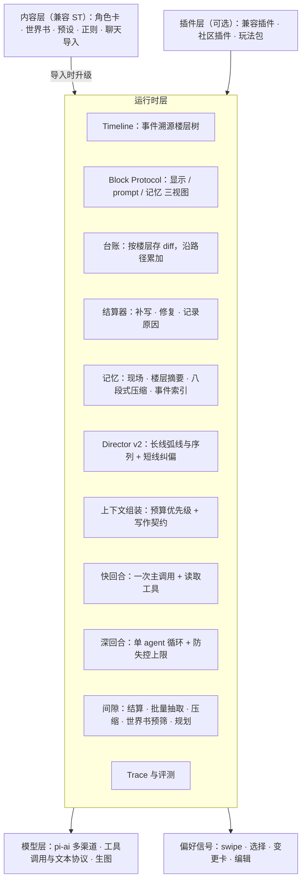

# Dramaticer 总设计案

> 版本：v0.3（2026-11-07）
> 状态：v3 路线已合并（ADR-0044），开发按「开局与方向 → 输出形态 → 记忆与台账最小集 → 生图」推进。标注「待验证」的条目必须在对应阶段用实测确认后才能当作事实。

---

## 0. 一句话

**Dramaticer 是一个 AIRP 故事引擎：内容层兼容酒馆生态，运行时是结构化的 harness。台账管事实，记忆管过去，导演管未来。**

## 1. 定位与目标

- **目标**：开源的社区项目，要成为 AIRP 新一代运行时的标杆。不是又一个酒馆前端。
- **主场景**：大型角色卡的长线剧情游玩（世界观大、角色多、几百到上千楼）。
- **要解决的两个根本问题**（来自作者本人的真实体验）：
  1. **遗忘与串戏**：AI 记不住早先发生的事，人物知道不该知道的事。由**记忆引擎**负责。
  2. **重复与停滞**：剧情原地打转，情绪节拍循环，伏笔无人回收。由 **Director** 负责。
- **不追求**：更好的文笔（这是模型的事）、更花哨的 UI、新的卡片或预设格式。
- **主菜排序**（v3，ADR-0044，依据 F0 取证）：①开局与方向；②输出形态；③记忆与台账最小集；④生图。别人靠一个更大的上下文或一个更好的模型做不到的四件事，按这个顺序投入；记忆增强里的压缩与检索改造保留范围，排在最小可玩版本与长对话评测之后。

## 2. 诊断：酒馆生态的病根

基于作者本机数据（3 个 ST 数据根、230 个去重后的对话、58 个预设、928 条预设正则）：

| 现象 | 数据 | 本质 |
|---|---|---|
| 每楼 24–153 KB | 银麒赎世 231 楼 35 MB（平均 153 KB），另两个评测对话 24–36 KB | 插件把表格哈希、单元格历史和整份状态写进每一楼 |
| 预设即程序 | 58 个预设 8004 个条目（启用 2361），setvar/getvar/addvar 9017 次 | 逻辑写在 prompt 文本里 |
| 正则身兼数职 | 928 条：38% 渲染 UI（其中 15% 带内联脚本），34% 删除内容，8% 删除思考链 | 展示和上下文管理靠字符串替换 |
| 记忆靠插件补 | ACU 表格覆盖 23.6% 的评测题（状态题 37.3%） | 记忆是额外塞进 prompt 的文本 |

**病根：一切都被字符串化了。** Dramaticer 的回答是把运行时结构化，同时保持对内容的兼容。

### 2.1 F0 取证：玩家重 roll 的真实原因

对 265 个去重对话、285 对重 roll 归因的结果（`docs/dev/reports/F0.md`）：

| 主因 | 占比 | 说明 |
|---|---|---|
| 不推进剧情 | 19.3% | 1–10 楼占 25.0% |
| 没听用户的指示 | 18.2% | 1–10 楼占 25.0%，次因 12.6% |
| 格式或状态栏 | 13.7% | 次因 26.7%，与截断一起构成输出形态问题 |
| 截断 | 13.0% | 回复 token P50 2,338，旧默认 `maxTokens` 1024 |
| 遗忘或前后矛盾 | 5.6% | 次因 2.1%，与上下文容量直接相关 |
| 拒答或说教、OOC、文笔、重复 | 14.0% | 合计 |

- 1–10 楼重 roll 率 24.9%，11 楼以后 7.0%–10.3%；楼层 ≤ 10 的 180 个对话里 62 个（34.4%）以一次重 roll 结束。
- 95.1% 的对话整段正文放得下 128K，楼层 ≥ 100 的 13 个里只有 1 个放得下；全文直接塞进上下文是可行的基线，不设为默认。
- 裁判聚合一致率 73.3%（门槛 65%）、位置偏差 4.1 个百分点，可用于扩展样本；1–10 楼子集 61.4%、切回较早 swipe 的子集 55.2%，单次判断不可用。
- 限制：归因只看最近 8 条消息、没有卡与世界书，长程遗忘被低估；「其他」16.1% 未进一步归因。

## 3. 核心原则

1. **事件溯源的楼层树**：楼层节点不可变；分支就是一条路径；所有视图都沿路径累加得出。
2. **原文永不修改**：模型原始输出原样存档；显示视图、prompt 视图、记忆视图都是派生出来的。
3. **台账是唯一的事实来源**：人物、关系、物品、场景、时间、线索、知情表、用户意志都由台账持有；所有写入（模型写的或后台补的）都经过结算器的校验与修复。
4. **程序管事实与调度，模型管文笔与意图**：不强制模型每轮输出结构化数据；模型主动写了就以模型写的为准，没写就由结算器补齐。
5. **间隙是免费算力**：回复落定后到玩家下一次输入之前的空档，做结算、批量抽取、压缩、世界书预筛与下一拍规划；回合内只做必须看到玩家输入才能做的事。
6. **两种回合模式，玩家手动切换**：快回合走预先备好的上下文加一次主调用；深回合由模型自己决定查什么、查多少。程序不自动切换。
7. **被动注入保底，工具调用补充**：模型不会去搜它不知道自己忘了的东西。
8. **原生优先，兼容是入口而不是枷锁**：核心按新时代的需要设计，不迁就 ST 的任何概念。ST 兼容由可选插件承担（§19），单向把 ST 内容转换成原生模型；`core` 里不出现 ST 概念，也不为了兼容扭曲核心设计。
9. **可观测、可评测**：每一轮都可以回看，每次改动都有数字衡量；没有赢过基线就继续改，不把未证实当成已完成。
10. **开局决定留存**：玩家在 1–10 楼的重 roll 率是后面的 2 倍以上；开局包、首楼多候选与前 10 楼的导演强度属于主菜，不是附属功能。
11. **玩家的行为是偏好信号**：重 roll、选项选择、变更卡的批准与拒绝是强信号，编辑是弱信号；信号用于校准评测，裁判只用于扩展聚合样本。
12. **插件化**：内置模块（槽位、Director 机制、块类型、后台任务、工具）也按插件实现，对外只暴露 Dramaticer 自己的类型；社区插件与兼容插件走同一套扩展点。

## 4. 总体架构

- 插件层：内置模块也按插件实现，兼容插件与社区插件走同一套扩展点（§19）；插件不能修改楼层原文，状态写入经过结算器。
- 偏好信号只追加地记录玩家的实际操作（重 roll、选择、变更卡决定、编辑），用于评测与校准，不进入剧情上下文。
- 导入时升级：正则变块策略，MVU 变量映射为台账里的 `mvu` 命名空间，ACU 表格转成初始记忆。
- 后台工作（结算、抽取、压缩、预筛、规划、议程推进、出图）使用独立渠道池并限速，不阻塞回合（I11）。
- 回合模式与后台工作都是同一个台账与同一份上下文的消费者，没有两套状态。

## 5. Timeline：事件溯源楼层树

每个楼层节点保存这些内容：

| 字段 | 说明 |
|---|---|
| raw | 模型或用户的原始文本，永不修改 |
| blocks | 解析结果（缓存，可以重建） |
| ledger_diffs | 本楼产生的台账变更，例如 `{path: ["人物", "卫宫", "relation", "凛", "外在好感"], op, value, reason, source}`；来源可以是模型写入或结算器补写 |
| events / notes | 本楼新增的事件索引与剧情线索 |
| summary | 本楼的结构化摘要，带故事内时间锚点（后台生成） |
| images / trace | 生图结果、本轮完整请求记录 |

- **swipe、重 roll、编辑**：都是新建一个兄弟节点，旧节点保留。
- **楼层确认**：用户基于某个节点继续发言，该节点就被确认，这时台账结算与后台抽取才有稳定的窗口。
- **台账快照**：沿路径累加 diff 得出，按节点缓存；快照只是计算缓存，不写入台账。
- **摘要依赖路径**：每条摘要与压缩记录它覆盖的节点区间；只有区间内的节点都是当前路径的祖先时，这条记录才有效。
- **MVU 命名空间**：有 MVU 的卡把变量映射到 `["mvu", ...]`；没有 MVU 的卡使用原生台账结构。两种卡共用同一条累加与快照路径。

## 6. Block Protocol：块协议

- **增量解析器**：识别 `<thinking>`、`<选项>`、`<页眉>`、`<悄悄话>` 等标签块，支持流式输出（块有"已闭合 / 未闭合"两种状态）。
- **每种块类型都有三套策略**：
  - **显示**：原生组件，或者沙箱 iframe 里的 HTML 模板（允许运行脚本，不同源，通过 postMessage 白名单接口交互）
  - **上下文**：保留 / 删除 / 保留到深度 N / 压缩
  - **语义映射**：块内容写入台账或记忆，例如 页眉→故事时间与地点，备忘→线索，选项→选项组件
- **结构化不是义务**：主模型可以输出原生块，也可以只写正文；块缺失时由结算器与后台任务补齐，不强制每轮输出固定结构（I13）。
- **prompt 视图（v3）**：历史槽位按块的上下文策略渲染。显示类块（状态栏、变量更新、分析、选项、图片）在历史里省略，最近一楼保留完整原文；未知块与未闭合块按原文保留；原文不动（I8）。Trace 记录每种块被省略的字符与 token，开关关闭时与完整原文逐字节一致。旧的默认 `maxTokens` 比回复长度 P50 小一半，历史里约 65% 的字符是这类块，两者一起构成输出形态的主菜。
- **显示**：最小界面必须渲染选项块（点击填入输入框，不自动发送）与图片块；状态栏用原生组件，不在主文档里执行脚本。
- **正则兼容分三层**：
  1. **原样执行**：兼容 ST 的正则引擎，支持作用范围、"只影响显示"和"只影响 prompt"开关、深度限制、宏替换。保底方案。
  2. **自动升级**：分析器把正则识别为块策略，比如删除思考块、按深度删除、把标签渲染成 HTML、流式版本合并进对应渲染器。用户可以撤回。
  3. **原生协议**：思考、选项、页眉、旁白、备忘提供原生块类型，并写入台账与记忆。

## 7. 台账与记忆引擎（管过去）

### 7.1 台账：唯一的事实来源

台账采用事件溯源：每楼存 diff，沿路径累加，分支切换时自动得到正确状态。写入全部经过结算器校验（I12）。

| 命名空间 | 内容 |
|---|---|
| 人物 | 身份、外貌、当前衣着与状态、位置；分主演与龙套两级 |
| 关系 | 有方向；类型、阶段、转折点；好感分内在与外在（五档文字），有惯性，没有充分依据不调整 |
| 物品 | 持有者、位置、来历、变动日志（同一件事不重复结算） |
| 场景 | 从大到小的地点树；当前现场（在场人物、姿势、氛围） |
| 时间 | 故事内时间锚点 |
| 线索 | 伏笔、约定、谜题；开启 → 推进 → 兑现 |
| 知情表 | 谁知道什么 |
| 用户意志 | 玩家明确表达过的偏好、底线和纠正；永远有效 |
| mvu | 有 MVU 的卡映射进来的变量命名空间 |

台账路径（ADR-0034）：第一段是命名空间，后续段按实体与字段展开；所有写入都是现有 `StateDiff`，不新增存储。实体级路径只允许删除，字段必须逐项写入。

| 路径 | 值 |
|---|---|
| `character.<id>.tier` / `.identity` / `.appearance` / `.outfit` / `.status` / `.location` | `tier` 取 `lead` 或 `minor`；其余为非空字符串 |
| `relation.<from>.<to>.type` / `.stage` / `.turningPoint` | 非空字符串 |
| `relation.<from>.<to>.affectionInner` / `.affectionOuter` | `敌对`、`冷淡`、`平常`、`亲近`、`倾心` 之一 |
| `relation.<from>.<to>.inertia` | 0 到 1 的数字 |
| `item.<id>.holder` / `.location` / `.origin` | 非空字符串 |
| `item.<id>.log.<条目 id>` | `{text, nodeId, at}`，三者都是非空字符串 |
| `scene.places.<地点 id>.parent` / `.name` / `.description` | `parent` 为非空字符串或 null；其余为非空字符串 |
| `scene.current.place` / `.posture` / `.atmosphere` | 非空字符串 |
| `scene.current.participants` | 非空字符串数组 |
| `time.current` | 非空字符串 |
| `clue.<id>.text` / `.openedAt` / `.updatedAt` | 非空字符串 |
| `clue.<id>.status` | `open`、`progress`、`fulfilled` 之一 |
| `knowledge.<知情者>.<条目 id>` | `{factId, text}`；`factId` 指向事件或线索，同一知情者对同一 `factId` 只写一次 |
| `userWill.<id>` | `{kind, text, sourceNodeId, createdAt}`，`kind` 取 `preference`、`boundary`、`correction` |
| `mvu.<原始变量路径…>` | 任意 JSON 值 |

`validateLedgerDiff` 校验命名空间、路径段、值类型与范围，错误信息带完整路径；`readLedger` 与前缀读取复用楼层快照缓存；`listLedgerEntities` 返回人物、关系与未兑现线索。导入 MVU 时把原始变量路径加上 `mvu` 前缀；没有 MVU 的卡不产生 `mvu` 命名空间。

每条事实还带两个元数据字段：`storyTime` 存为 `{start, end}`，起点与终点都可以为空，随 diff 进入 `state_diffs`；`source` 沿用 `StateDiff.source`，台账事实取 `model`、`settler`、`player`、`import`，正文模型经结构化输出写入的事实取 `model`。`readLedgerFacts` 沿路径回放，返回仍然成立的事实及其 `storyTime` 与 `source`；`readLedger` 仍是快照值视图。用户意志由间隙里的后台任务 `user_will` 捕获：读当前路径上最近的玩家消息，模型只返回明确表达的偏好、底线与纠正，`sourceQuote` 必须逐字来自窗口内的玩家楼层；程序按规范化正文的摘要生成稳定 id（`userWill.<id>`），同一正文不重复写入，只追加不删除，分支切换后只注入当前路径的条目。玩家用自然语言提出的修改先生成**变更卡**（`ledger_change_cards`，迁移 v24）：间隙任务 `memory_revision` 读当前路径上最近的玩家消息，模型只对明确的修改要求返回 `{text, sourceQuote, diffs}`，草案至少一条台账修改；`sourceQuote` 必须逐字来自窗口内的玩家楼层，一条修改不合格就整卡拒绝并把原因记在卡片上。卡片状态取 `pending`、`approved`、`rejected`、`rolled_back`。批准把 `diffs` 写成 `source` 为 `player` 的事实，玩家提出的卡片同时把同一段话记入 `userWill`；拒绝只改状态；回滚按卡片记录的原值追加反向 diff 恢复，原事实保留在变更历史里。结算器记下的冲突（`repairs` 的 `conflict` 动作）在结算事务里转成来源为 `settler` 的待定卡，批准前台账不变。`dramaticer ledger cards <story>` 列出卡片，`--approve`、`--reject`、`--rollback` 执行决定，R5 面板复用同一接口（ADR-0052）。

### 7.2 结算器

- 每次回复落定后在间隙运行，不阻塞回合；可以一次处理多个楼层。
- 模型主动写了台账变更，就以模型写的为准；没写就由结算器补上；写坏了就修复，并记录修复原因（借鉴故事神谕的诊断模式）。
- 输入是回复正文、当前台账快照、最近楼层原文与相关实体；输出是严格校验的台账 diff，不合格的条目整条拒绝并记录原因，重试按后台任务规则处理。
- 写入前把人物、地点、物品的名称对照实体与别名表换成规范写法；不认识的名称进候选表，同一结算窗口出现两次以上或被正文模型直接写入时立即建档。
- 与最近 `conflictWindowFloors`（默认 6）楼原文矛盾的结算事实不覆盖已有值，拒绝写入并以 `conflict` 动作记入 `repairs`，供变更卡复核。
- `knowledge` 条目按知情者与 `factId` 去重，同一事实不重复写入。
- 同一楼层重复结算不产生重复 diff；结算结果与楼层绑定，swipe 与编辑的新节点各自结算。

### 7.3 记忆分层

| 层 | 内容 | 写入方式 | 进入上下文 |
|---|---|---|---|
| 现场 | 最近 N 楼原文 | — | 常驻 |
| 现场分析 | 在场人物此刻想要什么、各自知道什么、张力在哪里 | 间隙里后台生成，绑定助手楼层 | 下一轮作为 `scene` 槽位注入 |
| 楼层摘要 | 每楼一段结构化摘要，带时间锚点 | 后台批量生成 | 按预算与相关性选取 |
| 章节压缩 | 八段式：剧情脉络 / 人物档案 / 关系网 / 世界与设定 / 物品与资源 / 伏笔与约定 / 当前情况（含暗线）/ 用户意志 | 后台在章节边界生成 | 主线常驻，近期章节按预算注入 |
| 主线 | 跨章节概览 | 后台生成 | 常驻 |
| 事件索引 | 只追加的事件，带时间、地点、参与者、重要度、知情者 | 批量抽取，一次调用处理一个窗口 | 多路融合检索 top-K；也可由 `memory_search` 主动查 |
| 原作资料包 | 同人卡的原作知识，每条事实标注原作时间点 | 应用内助手的资料员技能调研，玩家确认后启用 | 超过设定时间点的事实不注入 |
| 玩家画像 | 跨故事学习玩家口味 | 应用内助手，需玩家确认 | 低优先级提示，不覆盖用户意志 |
| 世界书 | 来自卡，基本只读 | 作者 | 常驻条目预筛后注入，其余按关键词与实体命中 |

- **检索**：BM25（FTS5）、向量（bge-m3，硅基流动）、实体命中（角色卡与世界书定义的实体加别名表）、重要度与新近度，按排名融合。读取时不调用 LLM。
- **父子分块**：检索匹配小块，命中后注入它所在的整段或整楼；小块负责命中精度，整段负责上下文完整。
- **重排序**：多路融合之后可选地把候选交给重排序模型（硅基流动的 bge-reranker）再排序；评测确认有提升才开启，没有提升就关闭。
- **知情者过滤**：注入给某个视角的记忆只包含该视角知道的内容；秘密由程序决定什么时候放出。
- **世界书预筛**：间隙里先用 BM25 便宜地预筛，再由后台模型判断相关性，结果供下一轮注入；回合内不额外调用模型。
- **上下文包复用**：检索结果、预筛世界书与现场分析按玩家楼层打包缓存；swipe 与重新生成直接复用，玩家编辑输入产生新节点时才重新计算。
- **间隙合并调用**：下一轮要用的工作（结算、现场分析、用户意志、世界书预筛）合并成一次结构化调用 `gap_pass`；章节压缩、事件回填、导演规划与 NPC 议程只在长于玩家思考间隙 P75 的间隙或会话结束后运行（I11）。后台任务按档位声明：`gap` 档（下一轮要用）在每次间隙执行，`deferred` 档（事件抽取、摘要、NPC 议程、后续的世界书预筛）只在间隙秒数达到故事设置 `gapPlanSeconds`（默认 212）或会话结束后执行；执行前楼层已经不在当前 head 路径上的任务直接丢弃，丢弃条数与关键间隙工作的未完成比例从存储层读出。20 楼样本上合并调用的结算一致率明显低于四个独立任务（ADR-0055），因此 `gapPassEnabled` 默认关闭；恢复开启前先完成分段边界与输出 token 预算两项改进（TASKS 的 R1-T07.b.d.a、R1-T07.b.d.b）。
- **记忆增强的次序由证据决定**：父子分块、重排序、八段式压缩与世界书预筛保留全部任务，排在最小可玩版本与长对话评测之后；长对话遗忘评测（R2-T09）给出遗忘是否随楼层加深而上升，四项的先后与默认开关据此确定。
- **预算取舍顺序**：用户意志 > 人物关系 > 未兑现线索 > 当前生效设定 > 历史细节 > 现场描写。预算上限只用来防止失控，不压缩模型的思考（I13）。

## 8. Director v2：导演（管未来）

### 8.1 长线层（后台生成）

- **弧线**：贯穿线 + 路标 + 难度 + 红线。
- **序列**：一组节拍；每一拍包含目标、起始迹象、契合点（具体到人和事）。
- 来源：根据卡、台账与未兑现线索自动生成；应用内助手的“参谋”技能与玩家商量得出；导入的剧本。
- 玩家可以编辑弧线与序列；后台规划器在间隙生成与修订，不阻塞回合。

### 8.2 短线层（每轮由程序选择）

- 输入：当前拍、强度（只铺垫 / 自然推进 / 尽快引爆）、纠偏信号（重复、停滞、线索太老、节奏阶段）。
- 从后台准备好的具体方案里挑一条，不调用模型（I9）。
- 注入时并进玩家消息末尾，并且只作为建议；附带“玩家行动优先，你可以按剧情需要调整”。
- 玩家可以完全关闭导演，或选择透明与盲盒两种模式。

### 8.3 落拍与候选行动

- **落拍检测**：结算器顺带判断当前拍是否完成；完成由程序翻到下一拍，不额外调用模型。
- **候选行动**：间隙里准备好 4 个行动加 1 个场景变化，玩家点一下填进输入框，不自动发送。
- **NPC 幕后议程**：章节边界后台推进，以“与此同时”的形式回到剧情里。
- **内容扩展**：弧线、序列与 NPC 议程可以写进卡的 `extensions.dramaticer` 字段；ST 会忽略这个未知字段，不影响兼容性。

### 8.4 开局导演（v3，主菜第一）

- **开局包**：故事创建或导入后，后台用卡、世界书与玩家开场白生成开场地点与时间、在场人物与各自当下想要什么、第一个可行动冲突、三条可选开场方向；存成故事级记录。玩家首次输入之前完成，回合内不调用模型（I11）。
- **前 10 楼强度**：导演配置按楼层深度分档，前 `openingFloors`（默认 10）楼使用更高强度；指令仍然具体到人和事，仍然只作为建议。
- **首楼多候选**：后台一次生成 2–3 个开场候选；玩家选一个成为当前路径的第一个助手楼层，其余保留但不进入路径，可以重新生成。候选不在回合内生成。
- **依据**：1–10 楼重 roll 率 24.9%（11 楼以后 7.0%–10.3%），1–10 楼的「不推进剧情」与「没听用户的指示」各占 25.0%。验收以重 roll 率与候选采用率为准。

## 9. Context Assembler：上下文组装

- **原生上下文模板**：由一组有序的段落组成；段落可以是静态文本、条件段（按状态或开关决定是否出现，取代 setvar/getvar 拼装逻辑），或 harness 槽位（ledger、lore、character、persona、summary、memory、history、scene、director、user_will、beat、protocol）。模板是结构化数据，不是拼出来的字符串。
- **写作契约**：原生主提示词的核心，保持精简。玩家输入是本轮演出指引，不是已经发生的剧情；玩家不是上帝，其他角色可以按人设拒绝、反对、打断；每轮都有剧情意义，不重复之前的正文；遵守台账里的用户意志。社区预设（破限、文风）叠加在上面，写作契约放在最靠近生成的位置：`protocol` 段是模板的最后一个段落，模板校验拒绝在它后面再放任何片段。
- **token 预算**：按 7.3 的取舍顺序裁剪；Trace 里标出每一段内容的来源和 token 数、被裁剪的段落与缺失的槽位。用户意志单独成段，优先级高于其它全部槽位与静态段，预算不足时它先保留。
- **世界书由后台为下一轮预先筛选**：回合内只读取预筛结果，不额外调用模型。
- **上下文包**：同一玩家楼层的检索结果、预筛世界书与现场分析打包缓存；swipe 与重新生成复用缓存，玩家编辑输入后按新节点重新计算。
- **缓存**：在不违背预设顺序的前提下保持前缀稳定。只依赖隐式缓存，不在缓存统计上投入精力。
- **ST 预设通过 st-compat 转换进来**：条目对应段落，marker 对应槽位，宏引擎在转换层按顺序求值（保证"前面 setvar、后面 getvar"的语义和 ST 一致）。预设里没有 Dramaticer 新增的槽位时，自动插到默认位置。
- **st-compat 的预设兼容范围**：条目、宏（含变量）、深度注入、预填充（渠道支持时）、采样参数、正则；不认识的字段原样保留，导出时写回。
- **prompt 视图**：历史槽位按 §6 的块策略渲染，显示类块在历史里省略；Trace 记录省略量与块类型。模板可选附带 `block_format` 段，只说明 `state_update` 与 `plot_note` 的格式，默认关闭，不要求模型输出（I13）。
- **ST 内容通过兼容插件进入**：卡、世界书、预设、宏、正则、EJS 与 MVU 由 §19 的可选插件转换成原生模板与槽位；`core` 不出现 ST 概念（I1、I15）。ST 的正则、宏与 EJS 只作用于来自 ST 的内容，不碰 harness 槽位。

## 10. 模型层

### 10.1 两种回合模式

| 模式 | 做法 | 上限 |
|---|---|---|
| 快回合 | 一次主调用加预先备好的上下文；模型可以按需调用读取工具 | 读取工具软上限默认 3 轮 |
| 深回合 | 同一个 agent 循环，开放全部工具；模型自行决定规划、查资料、写作与自检的步数 | 默认最多 40 次工具调用或 10 分钟，可配置 |

- **只能由玩家手动切换**：输入框旁边的“快 / 深”开关，可以对单轮生效，也可以锁定整个故事；程序不自动切换（I6）。
- **分两段交付（v3）**：先做快回合（R3），再做最小界面（R5），最后做深回合（R3b）。深回合完成之前，界面只提供快回合，模式开关不展示无法运行的选项。
- **进度事件**：深回合向界面推送“回忆中……”“查阅设定……”之类的阶段事件，正文照常流式输出。
- **工具少而通用**：深回合以搜索、阅读页面或条目、读写台账为核心，外加可选的联网搜索；不为每种数据各开一个工具。
- **运行中追加要求**：深回合执行期间玩家可以补一句要求，作为新的指引进入后续步骤，不需要中断重来。
- **草稿与提交分开**：模型先把正文写成草稿，可以自己反复修改，满意之后才提交为楼层；草稿实时投影到界面，玩家能看到写作过程；没有提交就结束的运行不产生楼层。
- **导演手记**：深回合给模型一本跨回合的笔记，它可以记下伏笔安排、人物动机与后续打算，下一次深回合可以读写。手记挂在楼层树上：每楼存修改、沿路径累加，每个分支有自己的版本。它是模型自己的工作材料，事实仍以台账为准（I12）。
- **运行日志**：模型调用、工具调用、草稿修改与提交都只追加地记录，并入现有 Trace；界面用时间线展示，进程崩溃后能看出停在哪一步。
- **模板里的深回合配置**：原生上下文模板可以附带深回合配置（开放哪些工具与技能、计划方式、防失控上限），卡作者可以为自己的卡定制深回合。
- **原生元数据保真**：深回合的多轮工具调用必须原样回放各家的原生元数据（尤其 Gemini 的思考签名），否则工具循环会出错；专门编写工具循环测试，并用中转渠道实测。
- **防失控上限**：上限只用来防止跑飞，不用来压缩模型的思考；达到上限时正常收束并记录 Trace。

### 10.2 渠道与可靠性

- **工具调用传输**：渠道体检判定工具调用稳定的，走原生函数调用；不稳定的，走文本协议（模型输出 `<tool>…</tool>`，由程序解析执行）。两种方式跑同一个循环、共用同一套参数校验。
- **pi-ai**（MIT，`@earendil-works/*`）：锁死版本，外面包一层 `core/llm` 接口；`identity` 的归属声明设为 `{ attribution: null }`。`pi-agent-core` 只保留给验证脚本，不进入运行时。
- **适配器顺序**：OpenAI 兼容 Chat Completions 优先（覆盖各种公益站和中转），Gemini 原生第二（赠金直连、gcli2api、Antigravity；未做端到端验证，见 ADR-0020）。
- **多渠道**：同一模型可以配多个渠道，按优先级自动切换；Trace 记录实际使用的渠道。
- **渠道体检**：检测真流式还是假流式、函数调用、思考输出、预填充、缓存统计是否可用，据此决定工具传输方式。
- **可靠性**：截断检测、abort 后续写、失败重试、切换渠道。
- **模型分工**：正文模型由玩家切换；后台任务用 Flash 级模型，使用**独立渠道池**并限速（I11）。
- **按岗位配置**：写作、结算与抽取、规划与条件判断、评测裁判各自配置渠道和模型，写在 `data/channels.yaml` 的 `roles` 段；Trace 记录角色与实际使用的渠道，缺省时回落到 `background` 或 `main`。裁判与写作必须来自不同模型家族（由模型名映射，映射不到时比较完整模型名；不比较 `baseUrl`），相同会在启动时直接失败。
- **生成长度**：故事设置 `maxTokens` 默认取 `min(4096, writer 模型声明的上限)`；三种截断（以 length 结束、标签未闭合、正文突然中断）都写进 Trace，试玩与记分牌统计截断率。
- **思考**：档位可切换（关闭 / 低 / 高），默认“低”，思考内容折叠显示。
- **模型名一律当作任意字符串透传**，不解析其中的前缀和后缀。

### 10.3 应用内助手

一个助手，多个技能。它和正剧隔离：不写楼层，不进入剧情上下文；复用深回合的 agent 运行时，只是工具集与权限不同。

| 技能 | 内容 |
|---|---|
| 排障（优先） | 读 Trace、上下文组装记录、检索分数、预算裁剪记录、台账与导演决策，解释“这一轮为什么这么写、为什么忘了某件事”，并给出可操作的修正（置顶某条记忆、修订台账） |
| 台账修订 | v2.1 的 A3，用自然语言生成变更卡 |
| 参谋 | 商量剧情走向，产出弧线、序列或剧情小品 |
| 资料员 | 为同人卡调研原作，产出原作资料包草稿 |
| 卡片工坊 | 读写角色卡、世界书与模板 |
| 设置向导 | 渠道、预设、模型、深回合配置 |
| 使用指南 | 内置只读的知识技能（使用说明、设计文档、排障手册），直接回答“怎么用” |

- **通过类型化的 server 接口操作**：读 Trace、改设置、生成变更卡都走接口，不靠模拟点击；截图只作为可选补充，不要求模型支持图片输入。
- **权限分三级**：只读、修改前确认、自动执行，由玩家设置。凡是影响剧情的修改（台账、记忆、设定、模板）一律走变更卡，需要玩家确认，并通过结算器校验（I12）。
- **体验**：在输入框里选择模型与思考强度；对话自动保存，可以搜索、重命名、删除；关掉抽屉后任务继续运行，有运行状态提示；上下文快满时自动压缩，也可以手动压缩；显示上下文用量环。
- **路线**：排障技能先做命令行版本 `dramaticer explain --node <id>`，排在 R2 之后（E-T01）；完整的抽屉界面与全部技能排在 R5 之后（H-T00）。

## 11. 工具、结构化输出与结算

| 类别 | 工具 | 时机 |
|---|---|---|
| 读取（快回合与深回合） | `memory_search`、`ledger_read`、`lore_lookup`、`state_get` | 生成前按需调用 |
| 读取（仅深回合） | 历史回溯、剧本读取、原作资料包；可选的联网搜索 | 由模型自行决定 |
| 写入（可选） | `state_update`、`plot_note` | 正文之后在同一个回复里输出，不增加往返 |
| 生图 | `illustrate` | M6 |

- **模型可以不调用任何工具，也可以不输出结构化数据**；后台结算器负责补齐台账，模型主动写的以模型写的为准（I13）。
- 写入工具只收集、不直接执行；全部写入经过结算器校验与修复（I12）。
- 函数调用与 `<state_update>…</state_update>` 文本标签两种传输方式共用同一套 schema 校验，非法条目整条拒绝并记录原因。

## 12. 生图

- **流程**：`illustrate(scene_spec)` → Prompt Compiler（读取角色视觉档案和当前状态）→ 按后端能力生成标签式或自然语言提示词 → 异步任务队列 → 结果挂到楼层节点上。
- **角色视觉档案**：基础外貌、服装和临时状态（链接到状态字段）、各后端专属配置（LoRA、NAI 角色提示词）、参考图、seed。导入卡时由 Flash 生成初版。
- **ComfyUI**：导入 API 格式的 workflow，按节点类型自动识别插槽，用户确认后保存成模板。由服务端直接调用，不需要 CORS 代理。
- **触发方式**：主模型调用 `illustrate`、Director 规则、用户手动；出图频率可调。
- **第一批只接 ComfyUI**（本机：秋叶整合包 v3.2），排在最小界面之后（M6）；第二批接 NovelAI、Grok、OpenAI 兼容图像接口。

## 13. 技术栈与工程

- **TypeScript 全栈，pnpm monorepo**：`packages/core`（纯库，含评测，不含任何 ST 概念）、`packages/st-compat`（ST 内容到原生模型的单向转换：卡、世界书、预设、宏、正则、对话、MVU、ACU；同时承载 `dramaticer` CLI 入口，兼容插件复用这里的转换函数）、`packages/protocol`（server 与 web 共用的 HTTP 与 SSE 类型和常量）、`packages/server`（`node:http` 提供本地 HTTP 与 SSE）、`packages/web`（React 加 Vite，移动端优先，中文优先）；插件包与这些包并列，依赖 `core`，`core` 不反向依赖（I15）。
- **Node 22.19+**（pi 的要求）。
- **存储**：SQLite 加 FTS5 加 sqlite-vec，单文件。数据目录默认是 `data/`，可以配置到别处。
- **网络**：默认只监听 127.0.0.1；开启局域网访问时必须设置访问密码；API key 只存在服务端。
- **协议**：MIT。
- **以后的分发形式**：Tauri 打包桌面端和移动端；Windows 一键启动。

## 14. 评测与成功标准

| 指标 | 测法 |
|---|---|
| 矛盾率 | 长程自动试玩中定期插入回忆型探针，LLM 裁判对照台账判断 |
| 编造回忆率 | 问一件从没发生过的事，看模型是否编造；按五类记忆题分别统计 |
| 对比胜率 | 盲测两两对比（LLM 裁判，交换顺序消除位置偏差） |
| 重复度、推进度、NPC 主动性 | 文本统计加 LLM 裁判 |
| 叙事质量 | 参考 TTCW 的评分表：独创性、人物发展、节奏、对话 |
| 首字延迟 P50/P95、每轮成本 | 分快回合与深回合统计 |
| 深回合的增益 | 同一个分支点，快回合与深回合各生成一次，做两两对比 |

- 记忆题按 LongMemEval 的五类出题：信息抽取、跨段推理、时间推理、知识更新、拒答。拒答题与编造回忆题共用判分口径。
- 裁判模型与写作模型必须来自不同模型家族（由模型名映射，映射不到时比较完整模型名），避免同一家模型给自己打分。

### 14.1 基线

- **B0 朴素模式**：Dramaticer 内置——卡 + 预设 + 最近 N 楼，没有记忆与导演，使用我们自己的渠道。
- **B1 历史回放基线**：玩家真实的 ST 对话本身就是“ST + 插件”的产物。在同一个分支点，让 Dramaticer 续写一段，和当时 ST 的真实回复做两两对比。**不调用本地 ST，零额度，是主力基线。**
- **B2 本地 ST 实测**（可选、小样本）：只在里程碑门槛使用；每次使用前在 HUMAN.md 申请并得到确认；单次门槛最多生成 60 次（I14）。

### 14.2 门槛规则

- 没有赢过基线，就自动生成改进任务，然后重新评测，最多三轮；之后写进 HUMAN.md 请人类决定。
- 不允许“记一笔未证实，然后继续往下做”。
- `docs/dev/SCOREBOARD.md` 记录每一轮基线对比的指标、样本数、模型别名与结论。

### 14.3 对照与历史数据

- **私有评测集**：作者本人的 3 个对话（仙侠雌竞 579 楼、银麒赎世、欲望世界 412 楼），以 TauriTavern 那份数据为准，只放在被 git 忽略的目录里。R1 用它们建立事件表并重跑记忆评测。
- **公开基准**：另外构建一套可以公开的长线 RP 记忆与剧情基准（使用 SFW 或合成卡），和项目一起发布；在 R2 建立，3 个私有对话不足以支撑门槛判断。
- **文笔与结构基线**：重复度、句长分布、对话占比与词汇丰富度继续用小说参照文本统计（ADR-0024）；脚本为 `pnpm --filter @dramaticer/st-compat reference`，余弦校准用 `reference:cosine`，私有报告 `eval-private/reports/reference.md`，统计版 `docs/dev/reports/reference-baseline.md`。
- **历史诊断数字**（M0–M3，不再作为进门门槛）：3 个对话 1,222 楼全部导入；原文、思考与 diff 合计平均单楼 8.3 KB；58 个预设全部可解析，正则自动升级率 47.1%（300/637）；记忆文本召回的状态题命中@20 13.6%，事件题命中@5 83.3%、@20 98.0%，状态层答案正确率 236/236；Director 开关回放的相邻块 Jaccard 0.0915 对 0.0940。这些数字作为回归对照保留，不替代 14.1 的基线对比。

### 14.4 对比实验（R2-T99 之后）

两项实验都必须在至少 3 个对话、固定轮数的同一批样本上比较；设计与结果写成 ADR，人类只看最终结论。

| 实验 | 候选 | 判定指标 |
|---|---|---|
| X1 世界模型表示方式 | ① 现有台账（硬事实）；② 台账加**实体 Wiki 页**（软知识：性格变化、关系史，带出处楼层与版本历史）；③ 时序知识图谱（事实标记失效而不删除，支持按时间点查询） | 矛盾率、编造回忆率、盲测胜率、每轮成本 |
| X2 Director 组织方式 | ① 现有方案与序列；② **剧情小品引擎**：单一对象，条件是自然语言或台账查询，间隙里一次调用批量判断，支持冷却、顺序约束、可否重复与兜底；卡作者可以在 `extensions.dramaticer` 里附带自己的小品 | 重复度、推进度、线索兑现率、盲测胜率、条件判断准确率 |

- **只有显著胜出才切换**：主要指标不劣于现有实现，且盲测胜率明显高于对照，才替换默认方案；否则保留现有实现，实验代码留在开关后面或删除。
- 实验不改 R3 的不变量：快回合与深回合仍由玩家手动切换，导演实时选择仍由程序完成（I6、I9）。

### 14.5 偏好信号与自动试玩

- **信号来源**：新建 swipe（重 roll）、选项块的选择、变更卡的批准与拒绝是强信号；编辑是弱信号。每条记录带故事 id、节点 id、种类与载荷，只追加，存在本地库，属于私有数据。
- **评测用法**：接受与放弃的回复对组成偏好测试集；同一写作模型下对两种 profile 重新生成，比较与玩家选择的一致率。裁判只用于扩展聚合样本（F0 聚合一致率 73.3%），单次判断不用于偏好；切回较早 swipe 的子集单列（该子集 55.2%）。
- **自动试玩**：原路线里的人类试玩全部取消，改为 CLI 与界面的自动试玩（模型模拟用户），报告分私有版与统计版，门槛在运行前写进报告（ADR-0028、ADR-0039）。

## 15. 路线图

| 阶段 | 产出 | 过关标准 |
|---|---|---|
| **M0** | 对话和卡的导入；体检报告（体积构成、宏和正则统计、正则分类、重复度）；评测集；BM25 基线 | 已完成 |
| **M1** | pi 技术验证；原生上下文模板跑通单轮生成；块解析器 | 已完成 |
| **M2** | 楼层树与记忆引擎 | 已完成（文本召回未达标，按 ADR-0023 原样报告） |
| **M3** | Director v1 | 已完成（效果目标按 ADR-0029 保留为未证实） |
| **M4** | server 骨架、故事导入、设置、SSE 回合 | T01–T06 已完成；T07 起并入 R5 |
| **R1 最小集** | 台账默认结构与 MVU 映射（已完成）；事实带时间与来源（已完成）；按岗位配置渠道；生成长度默认值；结算器（补写、修复、原因）；现场分析；块的 prompt 视图；用户意志捕获；自然语言修订记忆；`gap_pass`；批量事件抽取并为 3 个评测对话建事件表 | 回合内零后台调用；台账写入全部经过校验；块的 prompt 视图关闭时与完整原文逐字节一致 |
| **R3 快回合** | 快回合循环、单轮与故事级模式开关、文本协议兜底、写作契约 | 真实渠道 20 轮；工具轮数不超过软上限；程序不自动切换 |
| **O 开局与方向** | 开局包、开场导演与前 10 楼导演强度、首楼多候选 | 1–10 楼重 roll 率低于 F0 的 24.9%；候选采用率有记录 |
| **R2 评测底座** | B0 朴素模式、B1 历史回放基线；CLI 自动试玩；一致性探针；五类记忆题与编造回忆率；盲测与叙事质量评分；偏好信号；公开合成基准；长对话遗忘报告；`SCOREBOARD.md` | 能稳定给出 B0 与 B1 的对比数字，重复运行口径一致；门槛运行前登记 |
| **E** | 排障命令行 `dramaticer explain`：读 Trace、上下文分段、检索分数、预算裁剪、台账与导演决策 | 每个结论都有证据，零模型调用 |
| **R4** | Director v2：弧线与序列、后台规划器、落拍检测、候选行动、注入玩家消息 | 短线层零模型调用；建议具体到人和事；玩家可编辑与关闭 |
| **R5** | 能玩的界面：最小界面（聊天、swipe、台账只读、图片与选项块、模式开关）、server、其余面板、Playwright、60 轮自动试玩 | 端到端测试加自动试玩报告 |
| **M6** | 生图第一批：ComfyUI 与 `illustrate` 块显示 | 出图挂到楼层节点 |
| **R1 续** | 记忆增强：父子分块、重排序、八段式压缩、世界书预筛、上下文包复用 | 先后与默认开关由长对话遗忘报告决定；检索指标不劣于当前实现 |
| **R3b 深回合** | 单 agent 循环、草稿与提交、导演手记、运行日志、模板深回合配置、原生元数据回放 | 失败率明显低于 23%；程序不自动切换 |
| **P1 / P2** | 插件技术验证与内核改造：Context、注册表、内置模块逐个插件化 | 每改一个内置模块门禁与评测不退化 |
| **C** | 兼容插件：`st-content`、`st-mvu`、`st-ejs`、`st-helper-host` | 一致性测试与共存规则（ADR-0040） |
| **H** | 应用内助手：抽屉界面与全部技能 | 与正剧隔离；影响剧情的修改走变更卡；复用深回合运行时 |
| **X1 / X2** | 对比实验：世界模型表示方式、Director 组织方式 | 只有显著胜出才切换，否则保留现有实现 |
| **R6** | 效果门槛：对 B0 与 B1 达标（必要时 B2） | 赢过基线；没赢就自动改进并重评，最多三轮 |
| **P3–P5** | 声明式插件格式、代码插件（权限与隔离）、插件市场 | 权限清单与沙箱隔离 |
| **M5 / M7** | 公开 alpha；Tauri 打包 | 由各自的 T00 细化 |

- 阶段顺序（v3，ADR-0044）：R1 最小集 → R3 快回合 → O 开局与方向 → R2 评测底座 → E → R4 → R5 → M6 → R1 续 → R3b → P1/P2 → C → H → X → R6 → P3/P4 → M5 → P5 → M7。
- 原 R7「之后」的四项内容（兼容线、公开 alpha、生图、Tauri）已各自成为独立阶段，占位阶段取消；不变量复审由最后阶段的验收承担。

## 16. 明确不做

- 程序自动切换快回合与深回合（只能由玩家手动切换，I6）
- 每轮跑多个 agent，或让多个 agent 并行讨论（I7）
- 强制主模型每轮调用工具或输出固定结构（I13）
- 每轮实时让 LLM 审核 LLM（离线评测里用 LLM 当裁判可以；后台一致性检查不阻塞回合）
- 为了兼容 ST 而扭曲核心设计（原生格式可以按需设计，ST 内容通过可选兼容插件单向转换进来；导出给 ST 时用 `extensions.dramaticer` 携带原生数据）
- 在原生核心或 harness 里运行酒馆助手脚本、模拟 ST 内部 API（酒馆助手脚本与 HTML 状态栏由可选插件 `st-helper-host` 在沙箱 iframe 里支持）
- 每楼存状态快照（快照只是计算缓存）
- 依赖外部记忆服务
- 默认调用玩家的本地 ST 额度（B2 必须先在 HUMAN.md 申请，单次最多 60 次，I14）

## 17. 待验证事项

- pi-ai 的 Gemini 原生适配器能否把 `baseUrl` 指向 gcli2api 或 Antigravity
- pi-ai 的 OpenAI 兼容适配器在常用公益站上，流式、思考内容、工具调用是否正常
- 正文模型的思考配置参数和缓存行为（以官方文档加实测为准）
- 硅基流动 bge-m3 的限流和稳定性
- pi-ai 的图像模型目录能否覆盖 Grok 和 OpenAI 兼容图像接口
- `pi-durable` 是否和我们的楼层树有可以复用的部分
- 结算器从回复里抽取台账 diff 的准确率与修复率（R1 度量）
- 深回合相对快回合的增益是否显著（R6 度量）
- B1 历史回放的可比性：前缀上下文、模型与采样参数的差异要在报告里量化
- 文本协议下的工具调用稳定性是否足以承载深回合
- 玩家画像与候选行动的实际接受率
- 开局导演与首楼多候选能把 1–10 楼重 roll 率从 24.9% 降到多少（O 验收）
- 块的 prompt 视图在省略显示类块之后，盲测胜率与截断率的变化（R1-T02.b 度量）
- 偏好信号与裁判判定的一致率；编辑作为弱信号是否值得保留（R2-T07 度量）
- 世界模型是否值得换成实体 Wiki 页或时序知识图谱（X1 度量）
- Director 是否值得换成剧情小品引擎（X2 度量）

## 18. 后续方向（暂缓）

以下方向在基础效果达标之后再考虑，不建任务、不排进里程碑：

- **卡片技能**：修仙境界、战斗规则这类机制知识做成按需加载的文档。
- **技能格式**：卡片技能采用 `SKILL.md` 目录格式（与 Claude、omp、TauriTavern 互通），按需加载。
- **深回合里的“规划—批评—执行”**：可选的复杂工作方式，默认不开。
- **程序化检定工具**：掷骰、属性检定、资源消耗。
- **可选集成 WeKnora**：资料员通过 MCP 调用 WeKnora 处理原作资料，不作为依赖。
- **对外提供 MCP Server**：让外部 agent 查询故事数据。
- **本机计算 embedding**：作为硅基流动的离线备选。
- **上千楼的聊天界面**：虚拟列表与分页读取历史；这一条已经写进 R5-T05 的验收标准，不留在暂缓里。
- **多设备同步**：局域网与远程同步，排在 M7 之后。

## 19. 插件系统

插件系统按 `docs/proposals/plugins.md` 采纳（ADR-0045）。目标：社区可以自己定制与分享插件，这是 Dramaticer 作为独立产品的生态基础。参照 Cordis（Koishi 生态的元框架，MIT 上游）的五个概念，对外只暴露 Dramaticer 自己定义的类型。外部参考只借鉴设计，不复制其他项目的代码。

**内置模块也按插件实现**：上下文槽位、结算规则、Director 机制、块类型、后台任务类型、工具、模型渠道适配器全部走同一套扩展点。这样插件 API 必须足够用，社区也能替换任何一个内置模块；每把一个内置模块改成插件，门禁与评测数字都不得退化。

### 19.1 Context 与插件注册表

- **Context**：插件拿到的唯一入口。通过它注册钩子、注册扩展点实现、提供服务和访问服务。插件不直接持有存储、渠道或界面对象的引用。
- **插件定义**：一个函数、类或对象，带 `name`、`Config`（配置 schema，加载前先校验）、`inject`（依赖的服务名，依赖不可用时插件不加载）、`provide`（向外提供的服务名）。插件之间通过服务名互相依赖，实现可以替换（记忆检索、模型渠道适配器、生图后端都是服务）。
- **生命周期与副作用回收**：插件注册的钩子、定时器、后台任务在卸载时自动清理；支持热重载，重载期间旧实例的副作用先回收再装载新实例。
- **注册表**：启动时解析全部插件的 `inject` 与 `provide`，依赖缺失的插件不加载并在 Trace 里记录原因；同名服务被两个插件提供时启动失败。
- **类型边界**：上游内核（如果直接采用 Cordis）只在内部适配层出现，插件作者写的类型全部来自 `core` 的插件接口；上游版本变化不得改变插件作者看到的 API。

### 19.2 扩展点与分发模式

五种分发模式的含义：**emit** 通知全部订阅者、不收集返回值；**parallel** 并行收集全部结果；**serial** 按注册顺序依次执行、收集结果；**bail** 按注册顺序执行、第一个有结果的就停止并采用；**waterfall** 依次把同一个值交给下一个订阅者改写。

| 扩展点 | 分发模式 | 位置 | 约束 |
|---|---|---|---|
| 上下文槽位提供者 | parallel 收集 | 回合内 | 有时间预算，Trace 记录每个提供者的耗时与 token |
| 组装后的请求改写 | waterfall | 回合内 | 有时间预算；不能删除写作约定槽位 |
| 台账 schema 类型与校验规则（境界、好感度之类） | 注册 | 结算器 | 写入必须经过结算器（I12） |
| 台账变更否决或修正 | bail / waterfall | 结算器 | 同上；修正必须带原因 |
| Director 机制 | 注册 | 回合内 | 必须是同步纯函数，不调用模型（I9） |
| 剧情方案与剧情小品的来源 | 注册 | 间隙的后台 | 可以调用模型，走后台渠道池 |
| 后台任务类型（抽取、规划、分析等） | 注册 | 间隙的后台 | 走后台渠道池与限速（I11），按类型声明落定条件 |
| 块类型（标签、显示渲染器、上下文策略、语义处理） | 注册 | 解析器与界面 | 渲染在沙箱 iframe 里 |
| 工具（深回合与助手可用） | 注册 | 深回合、助手 | 声明权限级别（只读、修改前确认、自动执行） |
| 模型渠道适配器、生图后端 | 服务 | 模型层 | 渠道配置与故障转移规则由内核统一执行 |
| 导入器与导出器 | 注册 | 导入导出 | 导入成果同样经过结算器 |
| 界面面板与小组件 | 注册 | Web | 沙箱 iframe，通过受控接口通信 |
| 评测指标与裁判 | 注册 | 评测 | 不得访问私有数据之外的网络 |
| 回合生命周期事件（回合开始、楼层提交、分支切换等） | emit / serial | 各处 | 只读通知，或在限定范围内修改运行参数 |

### 19.3 两档插件

| 档位 | 内容 | 安全性 | 分发方式 |
|---|---|---|---|
| **声明式插件**（主力） | 台账 schema、剧情小品、原生模板、块渲染器（沙箱里的 HTML 模板）、`SKILL.md` 技能、导演配置、事件池 | 只有数据，没有代码 | 可以直接打包进角色卡的 `extensions.dramaticer`，像 ST 的卡附带世界书一样 |
| **代码插件** | 任意 JS，用 Context API 注册扩展点 | 需要明确授权，运行在 worker 隔离环境里 | 从 npm、git、zip 安装，带权限清单（网络、文件、模型调用、台账写入等），安装时展示 |

社区的大部分价值可以用声明式插件实现，卡作者就能写。代码插件留给真正需要它的场景。

### 19.4 清单、玩法包与卡片依赖

- **插件清单**：名称、版本、兼容的 Dramaticer 版本范围、`inject` 与 `provide`、配置 schema、权限、档位。
- **玩法包**：一组插件加配置（例如「修仙跑团包」「恋爱养成包」）。玩法包之间是有序的补丁层：后加载的包可以覆盖前面包的配置与单个插件的开关，用户在上面叠加自己的覆盖，不修改包本身的文件。
- **卡片声明依赖**：卡片在 `extensions.dramaticer` 里写明需要或推荐哪些插件与玩法包，导入时提示安装。这解决了 ST 生态里「这张卡要装某个扩展才能正常用，但没人告诉你」的问题。
- **按故事启用**：每个故事单独开关插件与覆盖配置；同一故事的各条分支共享这套配置。

### 19.5 插件市场

在应用内浏览、搜索、安装与更新插件，显示权限与档位，支持从 git 地址安装。公开发布之前完成。发布、上架这类对外操作仍然遵守发布边界，由人类执行。

### 19.6 执行顺序

| 阶段 | 内容 | 位置 |
|---|---|---|
| P1 | 技术验证：直接依赖 Cordis 上游（MIT）与自研精简版的比较（类型体验、热重载、依赖管理、包体积），写 ADR | 依赖 R5-T99 |
| P2 | 内核改造：引入 Context 与插件注册表，内置模块逐个改成插件，每改一个保持门禁与评测不退化 | 依赖 P1 与 R5-T99 |
| P3 | 声明式插件格式定稿；卡片可以打包声明式插件；导入时提示依赖 | 依赖 P2 |
| P4 | 代码插件：权限清单、worker 隔离、安装与更新；插件开发文档与示例插件 | 依赖 P3 |
| P5 | 应用内插件市场 | 依赖 P4 与 M5-T99 |

- **ST 兼容插件**：`st-content`、`st-mvu`、`st-ejs`、`st-helper-host` 全部做成可选的代码插件，顺序 P-A → P-C → P-B → P-D，不设放弃清单；忠实模式做一致性比对，共存模式做开关对照评测（ADR-0038、ADR-0040、ADR-0041 的 A10）；`core` 不出现 ST 概念（I1、I15）。这四项是 TASKS 的 C-T01–C-T05，依赖 P2，不由 P 阶段重复建立。

### 19.7 不变量与约束

三条插件不变量（`docs/proposals/plugins.md` 第七节）：

1. **只经由结算器写台账，楼层原文不可修改**：插件不能修改楼层原文，任何状态写入都必须经过结算器校验与修复。这是 I4 与 I12 对插件的直接延伸。
2. **回合内钩子有时间预算**：热路径上的插件钩子有耗时上限，超时跳过并写入 Trace，被跳过的扩展点与原因要能在 `dramaticer explain` 里看到。
3. **代码插件的权限必须声明并展示**：权限清单在安装时展示给用户；未声明的调用直接拒绝并记录，不做静默放行。

其他约束：

- **I9 对 Director 机制**：实时选择必须是同步纯函数，不调用模型、不做网络与磁盘访问；需要模型的工作放在间隙的后台。
- **I12 对台账扩展**：插件注册的 schema 与校验规则只在结算器内部生效，不能绕过校验路径直接写状态快照。
- **I8 对显示与 prompt**：块渲染器只影响显示，正则与渲染都不修改原文。
- **I13 对结构化**：插件不能强制主模型每轮输出某段结构化内容。
- **I15 对包边界**：插件可以依赖 `core`，`core` 不依赖任何插件；ST 语义只出现在兼容插件里。
- AGENTS.md 的不变量表是否加入这三条，由人类确认（HUMAN-10）；确认之前以本节为准。

## 附录 A：决策记录

| # | 决策 | 备注 |
|---|---|---|
| Q1 | ~~自用为主~~ → **面向社区的开源项目，目标是引领** | 2026-11-06 修正 |
| Q2 | 大卡长线剧情 | |
| Q3 | 兼容内容与脚本由可选插件支持：条目、宏、正则（`st-content`），EJS（`st-ejs`），酒馆助手脚本与 HTML 状态栏（`st-helper-host`，沙箱 iframe）；原生核心不模拟 ST 内部 API | 2026-11-07 按 ADR-0038 收敛 |
| Q4 | TypeScript 全栈 | |
| Q5/Q8 | Gemini 系模型；正文模型可切换，后台用 Flash | |
| Q9→Q24 | OpenAI 兼容优先，Gemini 原生第二 | 根据实际使用的渠道修正 |
| Q10/Q26 | 只依赖隐式缓存；可靠性优先于缓存 | |
| Q11 | 思考档位可切换，默认"低" | |
| Q12 | 硅基流动 bge-m3 | |
| Q13 | MVU 自动转换；没有 MVU 的卡由 Flash 推断 schema | |
| Q14 | 默认只监听本机；局域网访问必须设密码 | |
| Q15 | 移动端适配，中文优先 | |
| Q16–18 | 3 个私有评测对话；状态题用规则、事件题用 Flash；ACU 作对照组 | |
| Q19 | 多渠道自动切换 | |
| Q20 | 结构化输出双模式 | |
| Q21 | pnpm monorepo 三个包 | |
| Q22 | M0 范围（见路线图） | |
| Q23 | MIT，数据目录默认 `data/` | |
| Q25 | 渠道体检 | |
| Q27 | 后台任务用独立渠道池并限速 | |
| Q28 | 生图第一批只接 ComfyUI | |
| Q29 | 间隙承担结算、批量抽取、压缩、世界书预筛与规划；回合内只做必须看到玩家输入的事 | v2，ADR-0033 |
| Q30 | 快回合与深回合两种模式，只能由玩家手动切换 | v2，ADR-0033 |
| Q31 | 台账是唯一事实来源，结算器补写、修复并记录原因 | v2，ADR-0033 |
| Q32 | 不强制主模型每轮调用工具或输出结构化数据 | v2，ADR-0033 |
| Q33 | Director v2：长线层后台生成弧线与序列，短线层每轮由程序选择具体方案 | v2，ADR-0033 |
| Q34 | 评测以 B1 历史回放为主力基线，B0 为朴素对照，B2 需申请 | v2，ADR-0033 |
| Q35 | 没赢过基线就自动改进并重评，最多三轮 | v2，ADR-0033 |
| Q36 | 路线图改为 R1 至 R7，M4 剩余任务并入 R5 | v2，ADR-0033 |
| Q37 | v2.1 补充提案按三分法合并：A1–A9 直接采纳，X1/X2 用评测决定，暂缓项进后续方向 | v2.1，ADR-0035 |
| Q38 | v2.2 采纳：深回合的草稿与提交分开、导演手记按楼层存 diff、运行日志并入 Trace、模板附带深回合配置、原生元数据保真；应用内助手取代侧边 agent；排障命令行排在 R2 之后 | v2.2，ADR-0036 |
| Q39 | 主菜排序：开局与方向 → 输出形态 → 记忆与台账最小集 → 生图 | v3，ADR-0044 |
| Q40 | 阶段顺序：R1 最小集 → R3 快回合 → O 开局 → R2 评测 → E → R4 → R5 → M6 → R1 续 → R3b → P1/P2 → C → H → X → R6 → P3–P5 → M5 → M7 | v3，ADR-0044 |
| Q41 | 块的 prompt 视图默认省略显示类块，最近一楼保留完整原文；原文不动 | v3，ADR-0044 |
| Q42 | 偏好信号以重 roll、选择、变更卡决定为主，编辑只作弱信号；记录只追加并留在本地 | v3，ADR-0044 |
| Q43 | 人类试玩全部换成自动试玩加评测；兼容插件全部可选，不设放弃清单 | v3，ADR-0044 |
| — | LLM 层采用 pi-ai 和 pi-agent-core | M1 验证后才最终确定 |
| — | 独立应用，而不是 ST 扩展 | 楼层树和块协议与 ST 的数据模型冲突 |
| — | Director 提前到 M3，和记忆同等重要 | 作者两种痛点都有 |
| — | 原生优先：ST 兼容拆成独立的 st-compat 转换层，作为并行线，不阻塞主线 | 2026-11-06：不受旧时代掣肘 |
